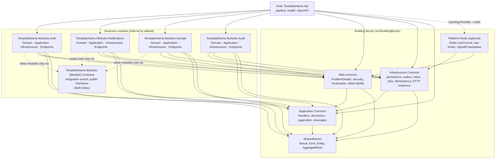
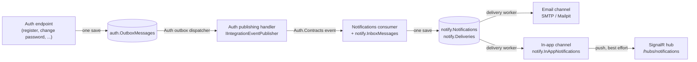

# Architecture overview

`TemplateName` is a modular monolith: one ASP.NET Core 10 process (`TemplateName.Api`) hosting business modules that each own their code, their SQL Server schema and their migrations. Modules share only the building blocks and talk to each other through `*.Contracts` projects. This page is the map; the details live in the linked documents.

## Module map

- **Host** (`src/Host/TemplateName.Api`, [`docs/services/api.md`](../services/api.md)) wires the building blocks and modules in `Program.cs`: services, the middleware pipeline, health checks, OpenAPI and the `/api/v1` route group.
- **Modules** (`src/Modules/{Module}`, one document per module under [`docs/modules/`](../modules/)) are two projects: `TemplateName.Modules.{Module}` with `Domain/`, `Application/`, `Infrastructure/`, `Endpoints/` and `Resources/` folders (a module that declares notification types also has `Templates/`, its embedded notification templates), and `TemplateName.Modules.{Module}.Contracts`, the only project another module may reference (ADR 0001). A module with nothing to offer other modules ships one project only (Notifications and Audit), and one that defines no error code has no `Resources/` folder (Audit). The entry point `{Module}Module` (`Add{Module}Module`, `Map{Module}Endpoints`) is the only public type.
- **Auth** ([`docs/modules/auth.md`](../modules/auth.md)) is the identity module: users, sessions, roles, permissions and the audit log in the `auth` schema, with the sign-in, token, password and administration endpoints, and two-step verification (an authenticator app with single-use recovery codes, a step-up before sensitive actions, trusted devices and an administrator's reset; ADRs 0022 to 0025). It implements `IPermissionChecker` for the whole host; no other module references it (its `TemplateName.Modules.Auth.Contracts` project holds its integration events and `IUserContactDirectory`; Auth publishes the events from its outbox, and the Notifications module consumes them).
- **Notifications** ([`docs/modules/notifications.md`](../modules/notifications.md)) is the module through which every message the template sends goes (Auth sends no email itself): it consumes the integration events other modules publish and renders and delivers them by email and in-app in the recipient's language. It holds the code-defined notification type catalog with its embedded templates, the recipient culture and time zone rules, its `notify` schema, the consumers of Auth's integration events (which create notification and delivery rows through its inbox), the delivery worker with the email (SMTP, `Notifications:Email`) and in-app channels, the inbox, preference and hub-ticket APIs, the SignalR hub (`/hubs/notifications`) that pushes new in-app notifications, and the administrator's delivery list and retry. It references `TemplateName.Modules.Auth.Contracts` only, never the Auth module, and no module references it.
- **Audit** ([`docs/modules/audit.md`](../modules/audit.md)) keeps the audit trail: who changed which field of which record, from which value to which, in the `audit` schema, read through `GET /api/v1/admin/audit/trails`. It is one project with no `.Contracts` project (it offers nothing to other modules), no `Resources/` folder and no error code. It references no module and no module references it: an entity marked `[Audited]` in any module has its changes written, in the same save, to that module's own outbox, and the Audit module consumes them as `EntityChangesRecordedIntegrationEvent` (defined in `Application.Common`) through its inbox. Auth's security log (`auth.AuthAuditLogs`) is a different log and stays in Auth (ADR 0030).
- **Building blocks** ([`shared-kernel`](../building-blocks/shared-kernel.md), [`application-common`](../building-blocks/application-common.md), [`infrastructure-common`](../building-blocks/infrastructure-common.md), [`web-common`](../building-blocks/web-common.md)) hold everything every module needs. [`platform-redis`](../building-blocks/platform-redis.md) is the exception: an optional project only the host references, active with `Caching:Provider = redis`, that a solution without Redis deletes (ADR 0027).

The arrows are project references, and architecture tests (`tests/TemplateName.ArchitectureTests`) enforce them: SharedKernel has no dependencies; Application.Common does not depend on Infrastructure.Common or Web.Common; a module's `Domain` depends on nothing but SharedKernel; its `Application` does not depend on its `Infrastructure` or `Endpoints`; no module references another module except its `.Contracts`; and only the host references Platform.Redis.

## Request lifecycle

A request passes the middleware in the order `Program.cs` registers it ([`docs/services/api.md`](../services/api.md#pipeline) has the full table):

```mermaid
flowchart LR
    Client --> FH["1 Forwarded headers"] --> AuthN["1a Authentication"] --> Loc["1b Localization"] --> EH["2 Exception handler"]
    EH --> SCP["3 Status code pages"] --> Trace["4 X-Trace-Id"] --> Sec["5 Security headers"] --> Https["6 HSTS + HTTPS redirect<br/>(not in Development)"]
    Https --> Log["7 Request logging"] --> Route["8 Routing"] --> Cors["9 CORS"] --> RL["9a Rate limiter"] --> AuthZ["10 Authorization"]
    AuthZ --> Idem["11 Idempotency-Key"] --> EP["12 Endpoint"]
```

**Authentication and authorization.** Every endpoint requires a signed-in user unless it says `.AllowAnonymous()` (the fallback policy). Authentication (slot 1a) validates the `Authorization: Bearer` access token, an ES256 JWT the Auth module issued, with no database read; a missing or invalid token leaves the request anonymous and never fails there. It runs before localization so the token's saved `locale` claim picks the response language ahead of `Accept-Language` (ADR 0009). Authorization (slot 10) runs after routing and the rate limiter: an endpoint with `.RequirePermission(code)` asks `IPermissionChecker`, which the Auth module implements over a per-user set cached for 30 seconds, because permissions are never carried in the token (ADR 0016). Anonymous callers get 401 and signed-in callers without the permission 403, both as ProblemDetails, and both are counted by the rate limiter. Other modules declare their permissions with `IPermissionSource` and depend only on `Application.Common`'s `IPermissionChecker` and `ICurrentUser`, never on the Auth module; the Sample module's `LeaveRequestEndpoints` is the example. A sensitive action asks for a fresh identity through the token's `auth_time` and `amr` claims (a step-up, ADR 0023), again with no database read. Details: [Auth module](../modules/auth.md#access-tokens), [Auth: Multi-factor authentication](../modules/auth.md#multi-factor-authentication) and [`docs/services/api.md`](../services/api.md#pipeline).

Inside an endpoint (the Sample module's `LeaveRequestEndpoints` is the worked example):

1. The endpoint binds the body or query (malformed input throws, and the exception handler answers `400 request.malformed`), builds a command or query record and calls the injected `ICommandHandler<…>` or `IQueryHandler<…>`.
2. The handler is wrapped by the decorators: logging (outermost) then validation. Validation failures return `400 validation.failed` with camel-cased field `errors` without reaching the handler (ADR 0005).
3. A command handler loads the aggregate through its repository, calls a domain method that returns a `Result` and raises domain events, and saves through the module's unit of work. In that one `SaveChanges` the interceptors run in this order: `AuditableEntityInterceptor` stamps the audit columns, `SoftDeleteInterceptor` turns deletes into soft deletes, `AuditTrailInterceptor` writes the field changes of `[Audited]` entities as one change set to the module's `OutboxMessages` table (ADR 0030), and `DomainEventsToOutboxInterceptor` writes the domain events to the same table (ADR 0006, ADR 0007). The audit trail runs after the soft-delete conversion, so a soft delete is already an update of `IsDeleted`, and before the domain events, so both kinds of outbox row are added in the same save.
4. A query handler reads with Dapper through `IDbConnectionFactory` and filters `IsDeleted = 0` itself; list queries page by cursor (ADR 0010).
5. The endpoint maps the `Result`: success to `200`/`201`/`204`, failure to RFC 9457 ProblemDetails via `ToProblem()` (ADR 0002). Every problem response carries `code`, `traceId` (equal to the `X-Trace-Id` header) and, when the error has parameters, `params`; `detail` is localized from the signed-in user's saved `locale` claim, else from `Accept-Language` (ADR 0009).
6. After the response, the module's outbox background service dispatches the saved domain events to their `IDomainEventHandler<>`s, at least once per handler (ADR 0007).

## Background work and several instances

Work that does not belong to a request runs in hosted services of the API process, and each takes its work under a SQL lease, so a second instance joins in without a second process and without doing the same work twice:

- **Outbox dispatchers**, one per module context with an outbox, publish saved domain events (ADR 0007).
- **The delivery worker** of the Notifications module sends emails and writes the in-app inbox ([Notifications](../modules/notifications.md#background-processing)).
- **The recurring-job scheduler** (`RecurringJobBackgroundService`, ADR 0026) runs the jobs that `AddRecurringJob` registered, one instance at a time per job, and records each run in `platform.JobStates`. Today every job is a cleanup that deletes what has outlived its retention in bounded batches: the outbox and inbox of each context, `platform.IdempotencyKeys`, and the Auth, Notifications and Audit tables ([`infrastructure-common`](../building-blocks/infrastructure-common.md#cleanup-jobs), ADR 0028).

State that is shared between instances is per instance by default: the permission cache, the rate-limit counters, the SignalR pushes. With `Caching:Provider = redis` the optional Platform.Redis project shares them, and the API serves from the database, degraded, when Redis fails (ADR 0027). Outbound HTTP calls go through named resilience pipelines with a timeout, retries and a circuit breaker (ADR 0029).

## Data ownership

One SQL Server database, one schema per owner, each with its own `__EFMigrationsHistory` table and its own `ready` health check named after the schema (ADR 0003). No module reads or writes another schema; cross-module data flows through integration events or `*.Contracts` interfaces.

| Schema | Owner | Context | Tables | Migrations |
|---|---|---|---|---|
| `platform` | Infrastructure.Common (building block) | `PlatformDbContext` | `IdempotencyKeys`, `JobStates` | `src/BuildingBlocks/TemplateName.Infrastructure.Common/Idempotency/Migrations/` |
| `auth` | Auth module | `AuthDbContext` | `Users`, `PasswordHistory`, `UserRoles`, `Roles`, `Permissions`, `RolePermissions`, `UserSessions`, `RefreshTokens`, `VerificationCodes`, `UserMfaMethods`, `RecoveryCodes`, `MfaChallenges`, `TrustedDevices`, `AuthAuditLogs`, `DataProtectionKeys`, `OutboxMessages`, `OutboxMessageConsumers` | `src/Modules/Auth/TemplateName.Modules.Auth/Infrastructure/Persistence/Migrations/` |
| `notify` | Notifications module | `NotificationsDbContext` | `Notifications`, `Deliveries`, `InAppNotifications`, `UserPreferences`, `UserSettings`, `HubTickets`, `InboxMessages` (no outbox) | `src/Modules/Notifications/TemplateName.Modules.Notifications/Infrastructure/Persistence/Migrations/` |
| `sample` | Sample module | `SampleDbContext` | `LeaveRequests`, `OutboxMessages`, `OutboxMessageConsumers` | `src/Modules/Sample/TemplateName.Modules.Sample/Infrastructure/Persistence/Migrations/` |
| `audit` | Audit module | `AuditDbContext` | `AuditTrails`, `InboxMessages` (no outbox) | `src/Modules/Audit/TemplateName.Modules.Audit/Infrastructure/Persistence/Migrations/` |

`MigrateModuleDatabasesAsync` applies every registered context's migrations in registration order (`platform` first, because `AddInfrastructureCommon` registers it before any module). The tables of each module are described in its document; `platform.IdempotencyKeys` in [`infrastructure-common`](../building-blocks/infrastructure-common.md#idempotency) and `platform.JobStates` under [recurring jobs](../building-blocks/infrastructure-common.md#recurring-jobs).

## Cross-module communication

There are four modules today (Sample, Auth, Notifications and Audit). Auth's outbox handlers turn eight domain events into the integration events of `TemplateName.Modules.Auth.Contracts`, which also holds `IUserContactDirectory` (see [`docs/modules/auth.md`](../modules/auth.md#events)); Notifications references that project only and consumes the events through its inbox (see [`docs/modules/notifications.md`](../modules/notifications.md#events)). Sample uses neither. The Audit module is fed differently: its input event, `EntityChangesRecordedIntegrationEvent`, is defined in `Application.Common` (not in a module's contracts, because every module's outbox publishes it and Audit must not reference every module's contracts), and every module's outbox runs one handler for it, registered once for the host. A contracts project references only `TemplateName.SharedKernel` and holds only public sealed records, enums and interfaces (`ContractsTests`). One message, from the endpoint to the recipient:

The rules for when a boundary is crossed:

- A module exposes integration events (`{Noun}{PastTenseVerb}IntegrationEvent`) and public interfaces only in its `.Contracts` project.
- Domain events stay inside the module. A domain event handler that must tell another module builds an integration event whose `Id` is the outbox message id (`IOutboxMessageContext.MessageId`) and calls `IIntegrationEventPublisher`, which runs every `IIntegrationEventHandler<T>` in the process, each in its own scope. A failing consumer makes the outbox retry the publish; each consumer records the event in its own module's inbox (`InboxMessages`) in the same save as its rows, so a repeat has no effect. Consumers only write rows. Cross-module effects are eventually consistent, never one transaction (ADR 0007, ADR 0018).
- A secret that must cross a boundary, such as a single-use link, travels only as `ISecretProtector` ciphertext: the owning module builds it and encrypts it, the consumer stores the ciphertext and decrypts it only in memory when it needs it (ADR 0020).

## Decisions

| ADR | Decision |
|---|---|
| [0001](../adr/0001-modular-monolith-two-projects-per-module.md) | Modular monolith with two projects per module |
| [0002](../adr/0002-result-pattern.md) | Result pattern for expected failures |
| [0003](../adr/0003-sql-server-only-v1.md) | SQL Server only for v1 |
| [0004](../adr/0004-sql-server-ordered-sequential-guids.md) | SQL Server-ordered sequential GUIDs |
| [0005](../adr/0005-injected-handlers-with-scrutor-decorators.md) | Injected handlers with Scrutor decorators instead of MediatR |
| [0006](../adr/0006-ef-core-writes-dapper-reads.md) | EF Core for writes, Dapper for reads |
| [0007](../adr/0007-per-module-outbox.md) | Per-module outbox with per-handler consumer tracking |
| [0008](../adr/0008-literal-v1-routes.md) | Literal `/api/v1` routes until a breaking change requires versioning |
| [0009](../adr/0009-internationalization.md) | Error codes as the contract, `detail` localized at the HTTP boundary from `.resx` |
| [0010](../adr/0010-cursor-pagination.md) | Cursor (keyset) pagination; Data API builder not used as the API layer |
| [0011](../adr/0011-in-repo-openapi-snapshot.md) | OpenAPI snapshot test with an in-repo comparer instead of a snapshot library |
| [0012](../adr/0012-sqlclient-native-runtime-licence-exemption.md) | Microsoft SqlClient native runtime components exempt from the licence allow-list |
| [0013](../adr/0013-prerelease-ef-core-opentelemetry-instrumentation.md) | Prerelease OpenTelemetry instrumentation for EF Core |
| [0014](../adr/0014-own-identity-model-with-identity-password-hasher.md) | Own identity model; ASP.NET Core Identity used only for password hashing |
| [0015](../adr/0015-es256-jwt-with-configured-signing-keys.md) | ES256 access tokens signed with keys from configuration |
| [0016](../adr/0016-server-side-permissions-with-per-user-cache.md) | Server-side permissions with a per-user cache |
| [0017](../adr/0017-outbox-secrets-protected-with-data-protection.md) | Single-use tokens in outbox events protected with Data Protection |
| [0018](../adr/0018-in-process-integration-events-with-inbox.md) | In-process integration events with a per-consumer inbox |
| [0019](../adr/0019-embedded-scriban-notification-templates.md) | Notification templates as Scriban files embedded in the declaring assembly |
| [0020](../adr/0020-secrets-in-cross-module-events.md) | Single-use links cross module boundaries encrypted |
| [0021](../adr/0021-signalr-hub-tickets.md) | SignalR hub authenticated by single-use tickets, never a JWT in the query string |
| [0022](../adr/0022-totp-secrets-and-replay-protection.md) | Own RFC 6238 TOTP with a monotonic replay guard, an Auth-only secret purpose and 80-bit recovery codes |
| [0023](../adr/0023-step-up-through-auth-time-and-amr.md) | Step-up through a fresh `auth_time` and `amr` in the access token, checked by `StepUpPolicy` |
| [0024](../adr/0024-mfa-challenge-as-a-hashed-server-side-token.md) | The sign-in challenge is an opaque token over a hashed server-side row, with wrong codes counted on it and in the lockout |
| [0025](../adr/0025-trusted-devices-bound-to-the-security-stamp.md) | Trusted devices are hashed bearer tokens bound to the security stamp, skipping the challenge only (`amr` `pwd`) |
| [0026](../adr/0026-recurring-jobs-on-our-own-scheduler.md) | Recurring jobs run on our own scheduler with a SQL lease, not Hangfire |
| [0027](../adr/0027-optional-redis-through-one-project.md) | Optional Redis through one project referenced only by the host (cache second level, rate limiter, backplane), degraded not down when Redis fails, our own fixed-window limiter, Valkey in compose |
| [0028](../adr/0028-retention-policy-and-the-inbox-window.md) | Retention per kind of data in bounded delete batches, dead letters kept, and an inbox window that outlasts outbox redelivery |
| [0029](../adr/0029-standard-http-resilience-pipelines.md) | Standard HTTP resilience pipelines from `Microsoft.Extensions.Http.Resilience`, named and bound from `Resilience:Pipelines`, with a breaker and the `hibp` budget |
| [0030](../adr/0030-audit-trail-through-the-owning-modules-outbox.md) | Audit trail through the owning module's outbox: `[Audited]` entities, one change set per save, consumed by the Audit module through its inbox; both logs kept, a delete window and no archive |
| [0031](../adr/0031-api-and-database-compatibility-policy.md) | API and database compatibility policy: literal `/api/v1` kept, an own OpenAPI breaking-change gate (the title's `!` accepts a break), `[ContractMigration]` for dropped or renamed columns and tables, `ApiVersion` and `ClientVersion` in the request log, a version register kept in step by a test |
