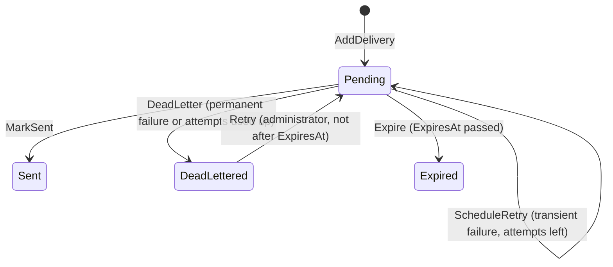

# Notifications module

<!-- Copied from docs/modules/_template.md. Each Notifications task updates the sections it changes; the module is built up over Plan 3. -->

## Purpose and boundaries

<!-- What the module owns, what it deliberately does not do, and which other modules it talks to (only through *.Contracts). -->

Every message the template sends goes through this module: it consumes the integration events other modules publish, renders a localized message in the **recipient's** language and delivers it by email and in-app. Plan 3 builds it task by task; this page describes what exists today (the skeleton, the notification type catalog with Auth's eight types and their templates, the recipient culture and time zone rules, the domain model, persistence, template rendering, the consumers of Auth's integration events with the scheduler that turns each event into a notification and its deliveries, the delivery worker with the email and in-app channels, the in-app inbox and preference APIs, the SignalR hub with its single-use tickets, and the delivery administration with its permissions) and lists the rest under the sections that will hold it. Every email the template sends, Auth's included, goes through the [email channel](#email-channel): Auth sends none itself.

- Owns: the notification type catalog, the notification, delivery and in-app rows, user preferences and quiet hours, the inbox that makes its consumers idempotent, and the `notify` schema (see [Data](#data)).
- Does not: send anything on its own initiative (it reacts to integration events), store a notification type table (D7: types are declared in code), or offer scheduling, cancellation, digests, push, SMS, webhooks, bulk sends, provider callbacks, attachments or fallback channels (D17).
- Talks to: `TemplateName.Modules.Auth.Contracts` only, never `TemplateName.Modules.Auth` (D1; `ModuleBoundaryTests` enforces it). It consumes Auth's integration events and, once when a notification is created, asks `IUserContactDirectory` for the recipient's address, name, language and time zone, which it snapshots on its own rows (D5). No other module references Notifications, so it has no `TemplateName.Modules.Notifications.Contracts` project yet; `INotificationTypeSource` and `NotificationTypeDefinition` move there when a module wants to declare its own types (D1).
- Consumers only write rows. A consumer records the event in `notify.InboxMessages` in the same save as the notification and its deliveries, so a repeated event has no effect (D3, [ADR 0018](../adr/0018-in-process-integration-events-with-inbox.md)); a separate delivery worker sends. Single-use links reach it as `ISecretProtector` ciphertext, which is stored unchanged; the plaintext exists only in memory, at two points: the scheduler's `http`/`https` check when the event is consumed (see [Security](#security)) and the rendering of the email in the delivery worker. It is never stored, logged or put in an exception message ([ADR 0020](../adr/0020-secrets-in-cross-module-events.md)).

Code: `src/Modules/Notifications/TemplateName.Modules.Notifications/`. The host calls `AddNotificationsModule(configuration)` after `AddAuthModule` (whose `IUserContactDirectory` the scheduler uses), maps `MapNotificationsEndpoints()` on the `/api/v1` group and `MapNotificationsHub()` on the application root; `MapNotificationsEndpoints` maps the [inbox, hub ticket, preference and quiet-hours routes](#endpoints) and the [delivery administration routes](#delivery-administration), and `MapNotificationsHub` maps the [SignalR hub](#realtime-hub) at `/hubs/notifications`. `AddNotificationsModule` registers the handlers and validators (the six Auth event consumers among them, see [Events](#events)), the scoped `NotificationScheduler`, the metrics (see [Observability](#observability)), the error messages (`NotificationsErrorMessages`), the `NotificationCatalog` singleton over every `INotificationTypeSource` (Auth's, `AuthNotificationTypeSource`, is registered here) and the hosted service that validates it at start, the template renderer (`INotificationRenderer`, see [Templates and rendering](#templates-and-rendering)), and the delivery worker (see [Background processing](#background-processing)): the singleton `DeliveryDispatcher`, the hosted `DeliveryBackgroundService`, `DeliveryOptions` (`Notifications:Delivery`, validated on start), the scoped `DeliverySaveCallbacks`, the channels (`EmailChannel` over `SmtpEmailTransport` with `EmailOptions` (`Notifications:Email`, validated on start together with `LegacyEmailSettingsCheck`), see [Email channel](#email-channel); `InAppChannel`), and the hub (`AddHub`, see [Realtime hub](#realtime-hub)): `HubOptions` (`Notifications:Hub`, validated on start), the `HubTicket` authentication scheme, SignalR, `SubClaimUserIdProvider`, `SignalRInAppNotificationPusher` as the in-app pusher and the rate-limit policy of the ticket route; and the module's permission source, `NotificationsPermissionSource` (see [Permissions](#permissions)).

## Endpoints

<!-- Every endpoint, written as METHOD + full route (e.g. GET /api/v1/{module}/{resources}/{id:guid}), with its success status and error codes. -->

The module's routes are `/api/v1/notifications/...` (the signed-in user's own, tag `Notifications`). Every one says `.RequireAuthorization()` explicitly (Ruling R13: not only through the fallback policy, so the OpenAPI document shows the bearer requirement): without a valid access token the answer is 401 `http.401`. The user is always the access token's (`ICurrentUser.UserId`), never an id taken from the request, and a token that carries no user id gets the same body-less 401. The delivery administration routes (`/api/v1/admin/notifications/deliveries...`, tag `Notifications administration`) are not the caller's own: each requires its own permission with `.RequirePermission(...)` (Ruling R13; 401 `http.401` without a valid access token, 403 `http.403` without the permission), see [Delivery administration](#delivery-administration). The SignalR hub at `/hubs/notifications` is not a REST route and is not in the OpenAPI document; see [Realtime hub](#realtime-hub).

| Method | Route | Purpose | Success | Errors |
|---|---|---|---|---|
| `GET` | `GET /api/v1/notifications/inbox` | The caller's in-app notifications, cursor-paged (`pageSize` default 20, 1 to 100; `cursor`; `sort` = `createdAt` only, default `-createdAt`; `includeTotalCount`; `unreadOnly`, default `false`); each is `{ id, typeCode, category, title, body, createdAt, readAt }` (see [Inbox](#inbox)). | 200 `{ items, pageSize, nextCursor, previousCursor, totalCount? }` | 400 `validation.failed` (`pageSize` out of range); 400 `pagination.invalid_sort`; 400 `pagination.invalid_cursor`; 400 `pagination.cursor_mismatch` (the cursor was made with another sort or another `unreadOnly`); 401 `http.401` |
| `GET` | `GET /api/v1/notifications/inbox/unread-count` | How many notifications the caller has not read, counted up to 1000: `{ count, isCapped }`. | 200 | 401 `http.401` |
| `POST` | `POST /api/v1/notifications/inbox/{id:guid}/read` | Marks one of the caller's notifications as read; the first read time is kept. | 204, also when it was already read | 401 `http.401`; 404 `notifications.notification_not_found` (an unknown id and another user's notification alike, never 403) |
| `POST` | `POST /api/v1/notifications/inbox/read-all` | Marks every unread notification the caller has as read. | 204, also when nothing was unread | 401 `http.401` |
| `POST` | `POST /api/v1/notifications/hub-tickets` | A single-use ticket for one request to the [hub](#realtime-hub): `{ ticket, expiresAt }`, 43 characters of base64url valid for `Notifications:Hub:TicketLifetime` (30 s). `Cache-Control: no-store`. At most `Notifications:Hub:TicketsPerMinute` (30) per user per minute. | 200 | 401 `http.401`; 429 `rate_limit.exceeded` (with `Retry-After`) |
| `GET` | `GET /api/v1/notifications/preferences` | Every notification type, by code, each with its channels: `{ types: [{ typeCode, category, channels: [{ channel, enabled, mandatory }] }] }` (see [Preferences](#preferences)). Not paged: the set is fixed in code. | 200 | 401 `http.401` |
| `PUT` | `PUT /api/v1/notifications/preferences` | Switches channels on or off for the items named (`{ items: [{ typeCode, channel, enabled }] }`, 1 to 100), all or nothing; answers with the updated preferences, as `GET` does. | 200 | 400 `validation.failed` (no items, more than 100, a blank or over-long `typeCode`, an undefined `channel`); 400 `request.malformed` (invalid JSON, a channel name that does not exist, a missing member); 400 `notifications.unknown_type`; 400 `notifications.channel_not_supported`; 400 `notifications.channel_mandatory`; 401 `http.401`; 409 `concurrency.conflict` (only after repeated conflicts) |
| `GET` | `GET /api/v1/notifications/preferences/quiet-hours` | The daily quiet-hours window and the time zone it is read in: `{ start, end, timeZone }` with `start` and `end` as `"HH:mm"` or null (see [Quiet hours endpoints](#quiet-hours-endpoints)). | 200 | 401 `http.401` |
| `PUT` | `PUT /api/v1/notifications/preferences/quiet-hours` | Replaces the window (`{ start, end }`, `"HH:mm"`); both null clears it. Answers with the new state, as `GET` does. | 200 | 400 `request.malformed` (a time that is not `"HH:mm"`, such as `"24:00"` or `"7"`); 400 `notifications.invalid_quiet_hours` (exactly one time, or two equal times); 401 `http.401`; 409 `concurrency.conflict` (only after repeated conflicts) |
| `GET` | `GET /api/v1/admin/notifications/deliveries` | Lists deliveries, cursor-paged (`pageSize` default 20, 1 to 100; `cursor`; `sort` = `createdAt` only, default `-createdAt`; `includeTotalCount`), filtered by `status` (`Pending`, `Sent`, `DeadLettered` or `Expired`), `channel` (`Email` or `InApp`), `typeCode` and `recipientUserId`; each is `{ id, notificationId, typeCode, recipientUserId, channel, destination, status, attemptCount, nextAttemptAt, lastError, createdAt, sentAt, deadLetteredAt }`, with `destination` masked (`a****@example.com`, null for in-app). Permission `notifications.delivery.view` (see [Delivery administration](#delivery-administration)). | 200 `{ items, pageSize, nextCursor, previousCursor, totalCount? }` | 400 `validation.failed` (page size, a `status` or `channel` number that names no value, a `typeCode` over 100 characters); 400 `request.malformed` (a `status` or `channel` that is not a value name, a `recipientUserId` that is not a guid); 400 `pagination.invalid_sort`, `pagination.invalid_cursor`, `pagination.cursor_mismatch` (the cursor was made with other filters or another sort); 401 `http.401`; 403 `http.403` |
| `POST` | `POST /api/v1/admin/notifications/deliveries/{id:guid}/retry` | Puts a dead-lettered delivery back in the queue, due now, with a fresh attempt budget; the delivery worker sends it on its next poll. Permission `notifications.delivery.retry`. | 202, no body | 401 `http.401`; 403 `http.403`; 404 `notifications.delivery_not_found`; 409 `notifications.delivery_not_retryable` (pending, sent or expired, or retried by another request just before); 409 `notifications.delivery_expired` (dead-lettered, but past its expiry) |

### Inbox

An inbox row is the in-app delivery's result (`notify.InAppNotifications`; its id is the delivery id). Nothing in this module deletes one, and none is soft-deleted.

- **Paging contract.** The list is keyset-paged on `(CreatedAt, Id)` ([ADR 0010](../adr/0010-cursor-pagination.md)): newest first, the unique id breaking ties between notifications created in the same instant, so walking forward or back visits every row exactly once. Rows that arrive after the first page was read do not shift the next page (the cursor holds a position, not an offset); walking back from a later page reaches them. `sort` accepts `createdAt` (oldest first) or `-createdAt`; any other field, and the id itself, is 400 `pagination.invalid_sort`. `totalCount` is written only with `includeTotalCount=true` and counts the filtered list (an extra query). `createdAt` and `readAt` are UTC (`...Z`), `category` is the enum name (`Security`, `Account`, `System`), and the text is already rendered in the language the recipient had saved when the notification was created.
- **`unreadOnly`.** Adds `ReadAt IS NULL` to the SQL. The cursor is bound to it (through the filter hash, together with the user): a cursor made for the full list and sent with `unreadOnly=true`, or the other way round, is 400 `pagination.cursor_mismatch`. A notification marked read while a client walks the unread list simply leaves the next pages.
- **Ownership.** The list, the count and both mark routes keep to the caller's rows in SQL (`UserId = @UserId`, a parameter). Another user's id is never read: marking one gives the same 404 body as an id that does not exist, so ids cannot be probed.
- **Indexes.** The list uses `IX_InAppNotifications_UserId_CreatedAt_Id` (`UserId`, `CreatedAt DESC`, `Id DESC`) in both directions, so no new migration was needed. With `unreadOnly` the same predicate adds a residual `ReadAt IS NULL`; the optimizer may use the filtered index `IX_InAppNotifications_UserId` (unread rows only) and sort instead, which is cheap while unread rows are few. If a user ever keeps tens of thousands of read rows and few unread ones, profile this query before adding an index.
- **Unread count and its cap.** `SELECT COUNT(*) FROM (SELECT TOP (1000) 1 AS x FROM notify.InAppNotifications WHERE UserId = @UserId AND ReadAt IS NULL) t`: the query never looks at more than 1000 rows, so a huge backlog costs the same as a small one. `isCapped` is true when the count reached 1000; **exactly 1000 unread is reported as capped too** (the query does not look past the cap, so it cannot tell 1000 from more). Clients show `1000+`; for the real number, page the list with `unreadOnly=true&includeTotalCount=true`.
- **Marking read.** `POST .../{id}/read` loads the row through `IInAppNotificationRepository.GetForUserAsync(id, userId)` and sets `ReadAt` from `TimeProvider` only while it is still null, so repeating it (or racing two calls) is harmless and keeps the first time. `POST .../read-all` is one `ExecuteUpdateAsync` (`MarkAllReadAsync(userId, now)`): it marks the caller's unread rows created at or before the server's `now` and leaves rows created later unread, so a notification that arrives while the user presses the button is not marked unseen.
- **Live updates** (the [hub](#realtime-hub)'s `notificationReceived`) are a convenience on top of these routes; the inbox is the source of truth, so a client that missed a push finds the row here (D13).

### Preferences

A preference is a user's choice to receive one notification type on one channel (`notify.UserPreferences`, key `(UserId, TypeCode, Channel)`). The default is **on** for every channel a type is delivered through; a row exists only for a choice that differs from the default (D10), so it is always a "switched off" row.

- **`GET`** lists **every** catalog type, in the ordinal order of its code (a stable order whatever the order the sources were registered in), each with its category (the enum name) and its channels in channel order (`Email`, then `InApp`; only the channels the type is delivered through). `enabled` is false only when the caller has a stored "off" row for that channel, and always true for a mandatory channel (a stale row cannot switch a security notice's email off); `mandatory` is `NotificationTypeDefinition.IsMandatory(channel)`. The answer is **not paged**: the set is declared in code, is small and does not grow with the data. Rows for a type or channel the catalog no longer has are ignored. Today the only optional channels are the in-app copies of `auth.password_changed` and `auth.token_reuse_detected`; every other `auth.*` type has one mandatory email channel.
- **`PUT`** applies the items named and leaves every other preference alone. It is **all or nothing**: every item is checked first, in request order, and the first invalid one answers the whole request and nothing is written: `notifications.unknown_type` (param `typeCode`), `notifications.channel_not_supported` (the type is not delivered through that channel; params `typeCode`, `channel`), `notifications.channel_mandatory` (switching off a mandatory channel; params `typeCode`, `channel`). **Switching a mandatory channel on is a no-op** (200, nothing stored). The shape is checked by `UpdatePreferencesCommandValidator` (1 to 100 items, no null item, a non-blank `typeCode` of at most 100 characters, a defined `channel`), and every member of an item is required: a body without `enabled` is 400 `request.malformed`, because a missing value must not mean "switch it off". `channel` is the enum name (`Email`, `InApp`).
- **Duplicates: the last wins.** Two items for the same type and channel in one request are applied in order. Every item is validated, including one that a later duplicate supersedes, so such a request can still be rejected.
- **Rows exist only when they differ from the default.** Switching a channel off adds its row (or keeps it); switching it on again **deletes** the row, and switching on a channel without a row stores nothing. The scheduler reads only the "off" rows (Scheduling, step 6), so a delivery created after the `PUT` honours it; deliveries created before keep the channels they were created with.
- **Concurrent updates of one row do not fail.** Two requests of the same user can create the same row (the key is the unique `(UserId, TypeCode, Channel)`) or delete it at once. `SaveChangesUnlessConflictAsync` answers false when the save hit a duplicate key (SQL Server 2627 or 2601) or an update or delete found its row changed (`DbUpdateConcurrencyException`); it drops the tracked entities and `ConflictRetry` reads the rows again and applies the request on top of what the other one did, up to two retries. The third attempt saves plainly, so a conflict that still remains surfaces as the usual `DbUpdateConcurrencyException` (409 `concurrency.conflict` through the host's exception handler) or, for a duplicate key, as a 500; two requests would have to lose the same race three times in a row.

### Quiet hours endpoints

The window is stored on the caller's `UserNotificationProfile` (`notify.UserSettings`, R4: the plan's `UserSettings`), created by the first `PUT` that sets a window; clearing when there is no row creates none. For what the window does, see [Quiet hours](#quiet-hours) and Scheduling, step 7.

- **Semantics.** A daily window `[start, end)` in the **recipient's Auth time zone**; `end` before `start` crosses midnight (22:00 to 07:00). It defers the **email** deliveries of **non-`Critical`** types to the window's end. In-app deliveries are **never** deferred and `Critical` types (every `auth.*` type) ignore it. It is evaluated once, when the delivery is created, so changing the window does not move a delivery that was already created (D11).
- **Time format.** `start` and `end` are 24-hour `"HH:mm"` strings (`"23:30"`, `"07:00"`), read and written by `HourMinuteJsonConverter`, which is attached to these properties and not registered host-wide (the default `TimeOnly` format is `"HH:mm:ss"`). Anything else (`"24:00"`, `"7"`, `"07:00:00"`, `"10pm"`, `""`, a number) is a `JsonException`, which the host answers with 400 `request.malformed`, never a 500.
- **Both null clears; one null or two equal times is 400 `notifications.invalid_quiet_hours`.** A body that omits a member counts that member as null, so `{}` clears. The check is in the handler (`QuietHours.Create`, which also refuses equal times) and not in a validator, because it answers with its own error code. Nothing is stored for a rejected request.
- **`timeZone` is read-only here.** It comes from Auth's `IUserContactDirectory`: the IANA id as stored, trimmed, and changed through `PUT /api/v1/auth/me`. When the stored id is empty or unknown (`TimeZoneResolver`), or the directory does not know the user, the answer is `UTC`, the zone the scheduler would use; the `GET` does not log (the scheduler warns when it really applies the fallback).
- **Concurrency.** `UserNotificationProfile.RowVersion` is a concurrency token. Two `PUT`s of the same user that collide (both creating the row, or both updating it) are settled by `ConflictRetry` exactly like preferences: the loser reads the row again and its window replaces the other's (a `PUT` is a full replacement, so the last one wins). A conflict that survives the retries is `DbUpdateConcurrencyException`, which the host maps to 409 `concurrency.conflict` (`ConcurrencyExceptionHandler`, registered by `AddInfrastructureCommon` before the global handler).

### Delivery administration

The handlers live in `Application/Admin/Deliveries/{List,Retry}/`, the routes in `Endpoints/AdminDeliveryEndpoints.cs` with the query string in `Endpoints/AdminDeliveryRequests.cs`. An administrator uses them to find deliveries that did not arrive and to send a dead letter again once its cause is fixed.

- **The list.** `ListDeliveriesQueryHandler` reads through Dapper (the notify tables have no soft delete, so there is no `IsDeleted` filter to forget) from `notify.Deliveries` joined to `notify.Notifications`, because a delivery has no type or recipient of its own. Paging is keyset on `(CreatedAt, Id)` in the way of the [inbox](#inbox): `sort` accepts `createdAt` or `-createdAt` only (default `-createdAt`), the delivery id breaks ties, and the cursor is bound to **all four filters** through the filter hash, so a cursor made for one filter set is 400 `pagination.cursor_mismatch` with another. `status` and `channel` take the value names the responses write (`DeadLettered`, `InApp`; the names are case-sensitive; a number that names no value is 400 `validation.failed`). `typeCode` is checked for length only, not against the catalog: a code no type has, or a type removed from the code, simply matches nothing or its old deliveries, and a blank `typeCode` is no filter. `totalCount` is written only with `includeTotalCount=true` and counts the filtered list.
- **Indexes (review P7).** The list is served by `IX_Deliveries_CreatedAt_Id` (`CreatedAt DESC, Id DESC`) either way round, and by `IX_Deliveries_Status_CreatedAt_Id` (`Status, CreatedAt DESC, Id DESC`) with the `status` filter, which is how dead letters are found among a mass of sent rows. `recipientUserId` is found through `IX_Notifications_RecipientUserId` (a user has few notifications, so sorting their deliveries is cheap). `channel` and `typeCode` have no index of their own: they narrow the rows those indexes return (two channels and a handful of types), and an index on a column with so few values would not make a page cheaper. Both new indexes arrived with `AddDeliveryAdminIndexes`.
- **The destination is masked in the handler.** `DestinationMask.Mask` keeps the first character of the local part and the whole domain: `alice@example.com` becomes `a****@example.com`; the asterisks are always four, so the length is not leaked. The first character is shown only when the local part has three or more characters (a letter with its accents, or an emoji, counts once); `a@example.com` and `ab@example.com` become `****@example.com`, because the first character would be all of the secret or half of it. The address is split at its last `@`; a value with no `@`, no local part or no domain is replaced by `****`; null, empty or blank (every in-app delivery) is null. The real address never leaves the handler, so no other code path can return it. `lastError` is a reason code (`smtp_550`), never free text, and the rendered subject is not part of the response.
- **The retry.** `RetryDeliveryCommandHandler` reads the delivery (`INotificationRepository.GetDeliveryAsync`) and calls `Delivery.Retry(now)`: only a **dead-lettered** delivery goes back, to `Pending` with `AttemptCount` 0, `NextAttemptAt` now and `LastError`, `DeadLetteredAt` and the lease cleared; the retry itself sends nothing. An unknown id is 404 `notifications.delivery_not_found`; a delivery in any other status is 409 `notifications.delivery_not_retryable`; a dead-lettered one whose `ExpiresAt` has passed is 409 `notifications.delivery_expired`, because resending it would deliver something stale (a dead reset link): its notification is not revived. A retried delivery is sent once. Two retries at once (a double click, two administrators) put it back once: `Deliveries.Status` is a concurrency token, so the second save finds the row no longer dead-lettered and fails, `ConflictRetry` reads the delivery again and the answer is 409 `notifications.delivery_not_retryable` (one 202, one 409, never a 500). For the same reason a retry decided on a stale read cannot turn a delivery the worker has since sent back into `Pending` (it would be sent twice).
- **Audit.** This module keeps no audit log (D16) and does not invent one. A retry shows in the delivery row (a new attempt budget, then its outcome: `Sent`, or dead-lettered again with the reason) and in one Information log line, `Delivery {DeliveryId} was put back in the queue by administrator {AdministratorId}`: ids only, never an address. Known limit: the row does not say who retried; the log line does, for as long as the host keeps logs.

### Permissions

Codes are `notifications.{resource}.{action}`. `NotificationsPermissionSource` (`Application/NotificationsPermissionSource.cs`, constants in `Application/NotificationsPermissions.cs`) declares them in module `notifications`; `AddNotificationsModule` registers it as a singleton `IPermissionSource`, which the Auth module's seeder syncs into `auth.Permissions` like every module's (the module never references Auth). Both are flagged `AdminDefault`, so the `Admin` role gets them in the run that first inserts them (see [Auth: Permissions](auth.md#permissions)); `SuperAdmin` holds every permission.

| Code | Allows | Route | `Admin` default |
|---|---|---|---|
| `notifications.delivery.view` | List notification deliveries and their status, with the destination masked. | `GET /api/v1/admin/notifications/deliveries` | yes |
| `notifications.delivery.retry` | Put a dead-lettered notification delivery back in the queue. | `POST /api/v1/admin/notifications/deliveries/{id:guid}/retry` | yes |

### Realtime hub

`/hubs/notifications` (`NotificationsHub`, mapped by `MapNotificationsHub` at the application root) pushes each new in-app notification to its user's open connections. It is decided by D12 and [ADR 0021](../adr/0021-signalr-hub-tickets.md).

- **Contract.** One server event, `notificationReceived`, whose payload is the inbox row (`InAppNotificationPushed`): `{ id, typeCode, category, title, body, createdAt }`, camelCase, `category` as the enum name (`Security`, `Account`, `System`), `createdAt` UTC. `id` is the inbox row's id (the delivery id), so a client that also reads the inbox can merge by id; `createdAt` is the time the row was created, which the inbox returns rounded to the millisecond. Clients cannot call anything: the hub declares no methods. The push happens after the delivery's outcome is saved, best effort (see [Background processing](#background-processing)), and only to connections on the instance that delivered it (D13: no backplane until Plan 5); the inbox stays the source of truth.
- **WebSockets only.** The hub allows no other transport (long polling and server-sent events make a request per poll, which a single-use ticket cannot cover); stateful reconnect is off.
- **Authentication.** Each connection is two requests, negotiate (`POST /hubs/notifications/negotiate`) and the WebSocket (`GET /hubs/notifications?id=...`), and each needs its own **ticket** from `POST /api/v1/notifications/hub-tickets`: a ticket works for one request, within 30 seconds, on this path only. The SignalR clients ask their token factory again for each request, so a factory that fetches a new ticket on every call is all a client needs (verified for the .NET and the JavaScript client, ADR 0021); a factory that caches its value fails the WebSocket request with 401. The `HubTicket` scheme reads the ticket from `access_token` (where a browser client puts it) or `Authorization: Bearer` (negotiate, and clients that can send headers). A client that can send headers may instead send its **access token** in `Authorization: Bearer`; an access token in `access_token` is always refused (401). An unknown, used or expired ticket is 401 too, without saying which.
- **Connection lifetime.** A connection opened with a ticket closes `Notifications:Hub:ConnectionLifetime` (10 minutes) after its ticket was consumed (`CloseOnAuthenticationExpiration`); one opened with an access token closes when that token expires. The client then starts again, with new tickets.
- **Users.** A connection belongs to the user in its `sub` claim (`SubClaimUserIdProvider`, the id in `Guid` form); `SignalRInAppNotificationPusher` sends with `Clients.User(userId)`, so every tab of the user receives it and nobody else does.
- **Cross-origin callers.** Negotiate passes through the CORS middleware like any route (`Cors:AllowedOrigins`, see [API host](../services/api.md#cors)). Browsers do not apply CORS to the WebSocket handshake and the hub checks no `Origin`: it accepts no cookie, so a hostile page has no credential to ride on, and it cannot get a ticket without the user's access token.
- **Logs and traces.** The ticket is never logged: the request log has the path only, and `access_token` values are masked in every Serilog event and in the `url.query` trace tag ([Web.Common](../building-blocks/web-common.md#observability)).

A browser client (`@microsoft/signalr`), with `getAccessToken()` standing for however the application holds its access token:

```js
import * as signalR from "@microsoft/signalr";

const api = "https://api.example.com";

// Called once for negotiate and once for the WebSocket, every time the client connects: always fetch a new ticket.
async function fetchHubTicket() {
  const response = await fetch(`${api}/api/v1/notifications/hub-tickets`, {
    method: "POST",
    headers: { Authorization: `Bearer ${await getAccessToken()}` },
  });
  if (!response.ok) {
    throw new Error(`No hub ticket: ${response.status}`);
  }
  return (await response.json()).ticket;
}

const connection = new signalR.HubConnectionBuilder()
  .withUrl(`${api}/hubs/notifications`, {
    accessTokenFactory: fetchHubTicket,
    transport: signalR.HttpTransportType.WebSockets,
  })
  .withAutomaticReconnect()
  .build();

connection.on("notificationReceived", (notification) => {
  // { id, typeCode, category, title, body, createdAt }: add it to the inbox view (merge by id) and raise the unread count.
});

// The server closes the connection when its authentication expires (every 10 minutes), and automatic reconnects can give up:
// start again after a pause.
async function start() {
  try {
    await connection.start();
  } catch {
    setTimeout(start, 5000);
  }
}
connection.onclose(() => setTimeout(start, 1000));
await start();
```

## Domain model

<!-- Aggregates, their invariants and life cycle. Draw state machines as a Mermaid stateDiagram-v2. -->

The domain is pure: no persistence (`Infrastructure/Persistence/` maps it, see [Data](#data)) and no handlers yet, no clock (every method takes `now`) and no encryption. Timestamps are UTC. Types with a `DateTime` property (`Notification`, `Delivery`, `InAppNotification`) store `now.UtcDateTime`; settings, preferences and hub tickets keep `DateTimeOffset`. Text from outside is cut to its column by one helper, `BoundedText.Cut` (`Domain/`), which never leaves half of a surrogate pair.

| Type | What it is |
|---|---|
| `Notification` (aggregate root) | One message to one recipient: `TypeCode`, `RecipientUserId`, `Priority`, the snapshotted `Culture`, `Data` (JSON of non-secret variables), `ProtectedData` (JSON of secret variable to `ISecretProtector` ciphertext, stored as given and never decrypted or printed by the domain), `CorrelationId` (cut to 32), `SourceMessageId` (the integration event id), `CreatedAt`, `ExpiresAt`. `AddDelivery(channel, destination, firstAttemptAt, now)` adds at most one `Delivery` per channel (a second one for the same channel throws `InvalidOperationException`) and copies the expiry onto it. An email delivery needs one plain address as its destination (`EmailDestination`, see [Security](#security)); anything else throws `ArgumentException` without quoting it. |
| `Delivery` (entity) | One channel's attempt series: `Channel`, `Destination` (email address, at most `MaxDestinationLength` = 320 characters; null for in-app), `Status`, `AttemptCount`, `NextAttemptAt` (null unless `Pending`), `LockedUntil` (the worker's lease), `LastError` (a reason code such as `smtp_550` or `render_failed`, never free text; cut to 200), `RenderedSubject` (cut to 300), `CreatedAt`, `SentAt`, `DeadLetteredAt`, `ExpiresAt`. |
| `InAppNotification` (entity) | The inbox row of an in-app delivery. Its id **is** the delivery id, so a retried delivery cannot insert a second row. `Title` is cut to 200 and `Body` to 2000. `MarkRead(now)` is idempotent and keeps the first time. |
| `UserPreference` | A per type and channel choice (`IsEnabled`), key `(UserId, TypeCode, Channel)`; stored only when it differs from the type's default (D10). |
| `UserNotificationProfile` (entity, key `UserId`) | The user's settings that are not per type: `QuietHours` (or none), `UpdatedAt` and a `RowVersion`. The plan calls it `UserSettings`, a name the naming rule G5 forbids. |
| `QuietHours` (record) | A daily local window `[Start, End)`; crosses midnight when `End < Start`. `Create` refuses `Start == End`. |
| `HubTicket` (key `TokenHash`, 32 bytes) | A single-use credential for the SignalR hub: `Issue(userId, hash, lifetime, now)`, `CanConsume(now)` (unconsumed and `now < ExpiresAt`) and `TryConsume(now)`. The database claims it with one conditional update; the method states the same rule. |
| `DeliveryRetryPolicy` | `NextAttemptAt(failedAttempts, utcNow, maxAttempts)`: 1 minute, 5 minutes, 15 minutes, 1 hour and 6 hours after failed attempts 1 to 5, 6 hours after any later one; `null` once `failedAttempts >= maxAttempts`. It is `internal` like every module type (the architecture tests allow no other public type than the module entry point). |

### Delivery life cycle



`Sent` and `Expired` are final. `Retry` works only from `DeadLettered` and only before `ExpiresAt` (`now < ExpiresAt`); it sets `AttemptCount = 0` and `NextAttemptAt = now` and clears `LastError`, `DeadLetteredAt` and the lease. `ScheduleRetry(reason, nextAttemptAt)` keeps a delivery `Pending` after a transient failure, with the later `NextAttemptAt` from `DeliveryRetryPolicy` and the reason code in `LastError` (cut to 200). The attempt count and the lease belong to the delivery worker's claim (D14): it counts the attempt and sets `LockedUntil` when it claims, so `MarkSent`, `ScheduleRetry`, `DeadLetter` and `Expire` never count attempts; they release the lease (`MarkSent`, `DeadLetter` and `Expire` also clear `NextAttemptAt`). All four throw `InvalidOperationException` from any status but `Pending`.

### Quiet hours

`QuietHours.NextAllowedAt(now, zone)` returns `now` when the local time is outside the window, else the next local `End` converted to UTC. Daylight saving is handled by the zone rules, not by arithmetic on offsets:

- An `End` that does not exist (spring forward) becomes the first valid instant after the gap. For the window 01:00 to 02:30 in `America/New_York` on 2026-03-08, 02:30 does not exist and the result is 03:00 EDT (07:00 UTC).
- An `End` that happens twice (clocks go back) takes the earlier offset, unless that instant is not after `now` (the user is already in the second occurrence); then the later one, so the result is never in the past. For 22:00 to 01:30 on 2026-11-01 the result is 01:30 EDT (05:30 UTC).
- Kuala Lumpur has no daylight saving: 23:30 MYT on 2026-03-01 with the window 22:00 to 07:00 gives 07:00 MYT the next day, 2026-03-01T23:00Z.

The enums below are stored as `tinyint`, so their numbers never change or get reused (`Domain/Notifications/`, `Domain/Deliveries/`).

| Enum | Values |
|---|---|
| `NotificationChannel` | `Email = 1`, `InApp = 2` |
| `NotificationCategory` | `Security = 1`, `Account = 2`, `System = 3` |
| `NotificationPriority` | `Low = 1`, `Normal = 2`, `High = 3`, `Critical = 4` |
| `DeliveryStatus` | `Pending = 0`, `Sent = 1`, `DeadLettered = 2`, `Expired = 3` |

`Critical` ignores quiet hours (D11).

## Notification types

A notification type is declared in code as a `NotificationTypeDefinition` (`Application/Catalog/`): a `Code`, a category, a priority, the default channels, the mandatory channels (the recipient cannot switch these off), the template variables and the secret variables (a single-use link; never shown in a subject or an in-app text, and refused by the scheduler unless it decrypts to an absolute `http` or `https` URL). `IsMandatory(channel)` and `IsConfigurable` (some default channel is not mandatory) are derived. A type's templates are embedded in the assembly that declares it (D8), so a type source says nothing about them.

An `INotificationTypeSource` returns the types it declares. `NotificationCatalog` (singleton) reads every registered source and validates it the first time it is used and again when the host starts (`NotificationCatalogStartupCheck`, a hosted service), so an invalid declaration stops the start. A failure throws `InvalidOperationException` naming the code and the source type. The rules:

| Rule | Detail |
|---|---|
| Code | Matches `^[a-z]+\.[a-z_]+\z` (`auth.password_changed`) and is at most 100 characters. |
| Unique | No code is declared twice, within one source or across sources; the message names both source types. |
| Channels | At least one default channel; every mandatory channel is also a default channel. |
| Variables | Variable and secret variable names match `^[a-z][a-z0-9_]*\z`, and no name is both. |

`Find(code)` returns a type or `null`, `All` lists them and `TemplateAssemblyOf(code)` returns the assembly of the source that declared the type, where its templates live. ### Auth's types

`AuthNotificationTypeSource` (`Application/Catalog/`, codes as constants in `AuthNotificationTypes`) declares the eight types Auth's integration events turn into (D6, D7, D10). Every one is category `Security`, priority `Critical` (it ignores quiet hours) and has a **mandatory email** channel. Only `auth.password_changed` and `auth.token_reuse_detected` also have an in-app channel, which is **optional** (the user can switch it off), so those are the only two types the preferences API can change. `display_name` is a variable of every type.

| Code | Source event (Auth.Contracts) | Channels (mandatory) | Variables | Secret variable |
|---|---|---|---|---|
| `auth.email_verification` | `EmailVerificationRequested` | Email (Email) | `display_name`, `expires_in_minutes` | `action_url` |
| `auth.password_reset` | `PasswordResetRequested`, reason `SelfService` | Email (Email) | `display_name`, `expires_in_minutes` | `action_url` |
| `auth.password_reset_required` | `PasswordResetRequested`, reason `ForcedByAdmin` | Email (Email) | `display_name`, `expires_in_minutes` | `action_url` |
| `auth.account_created` | `PasswordResetRequested`, reason `CreatedByAdmin` | Email (Email) | `display_name`, `expires_in_minutes` | `action_url` |
| `auth.registration_attempted` | `RegistrationAttempted` | Email (Email) | `display_name` | none |
| `auth.password_changed` | `PasswordChanged` | Email, InApp (Email) | `display_name`, `occurred_at`, `time_zone` | none |
| `auth.account_locked` | `UserLockedOut` | Email (Email) | `display_name`, `locked_until`, `time_zone` | none |
| `auth.token_reuse_detected` | `RefreshTokenReuseDetected` | Email, InApp (Email) | `display_name`, `occurred_at`, `time_zone` | none |

`expires_in_minutes`, `occurred_at` and `locked_until` are passed already formatted for the recipient (templates have no formatting functions); `time_zone` is the recipient's IANA id. The consumers that fill them are listed under [Events](#events).

**Templates.** 72 email parts (8 types, 3 cultures, `subject`, `text`, `html`) and 12 in-app parts (the two types above, 3 cultures, `title`, `body`) under `Templates/`; the other six types have no in-app templates. Every email greets the recipient by `display_name`. The four link types show a button and the address to copy in the `html` part and the address on its own line in the `text` part, say the link works once and expires in `expires_in_minutes` minutes, and say what to do if the reader did not ask for it: ignore the email (`auth.email_verification`, `auth.password_reset`) or do not use the link and contact the administrator (`auth.password_reset_required`, `auth.account_created`). `auth.registration_attempted` says someone tried to sign up with the address and carries no link. `auth.password_changed` and `auth.token_reuse_detected` give the time as `occurred_at (time_zone)` and tell the reader to reset the password now if it was not them; `auth.account_locked` gives `locked_until (time_zone)`, says the lock lifts by itself and tells the reader to reset the password if it was not them. In-app bodies are one or two sentences with no link. `action_url` appears only in the `text` and `html` parts of the four link types; no subject, title or in-app part uses it (a completeness test enforces this).

**Copy review status.** The English wording follows the emails Plan 2's Auth module built in code (removed in the email cut-over). The `ms` and `zh-Hans` subjects, titles and bodies are drafts written for consistent, unambiguous security wording; a native speaker has not reviewed them yet (Plan 3 Part C1, together with the error-message and layout translations). Until then, treat them as drafts when changing the English copy: update all three cultures in the same commit.

## Recipient culture and time zone

Notifications use the recipient's saved settings, never the request culture or the operating system's (`CultureInfo.CurrentUICulture` is not read).

- `RecipientCulture.Resolve(locale)` returns the first of `en`, `ms`, `zh-Hans` found by walking the locale and its parents with `CultureInfo.GetCultureInfo(locale, predefinedOnly: true)`: `zh-CN` and `zh-SG` give `zh-Hans`, `ms-MY` gives `ms`, `en-GB` gives `en`. A null, blank, invalid or unsupported locale (`fr-FR`, `zh-Hant`) gives `en`.
- `TimeZoneResolver.Resolve(ianaId)` returns the zone `TimeZoneInfo.TryFindSystemTimeZoneById` finds (an IANA id such as `Asia/Kuala_Lumpur`; a runtime with ICU also maps Windows ids), else `UTC` with `IsFallback = true` so the caller can log that the id was unusable. Quiet hours use it (D11).

## Templates and rendering

Every message is rendered from Scriban templates embedded in the assembly of the source that declares its type ([ADR 0019](../adr/0019-embedded-scriban-notification-templates.md), D8). The code is in `Infrastructure/Templates/`; callers use `INotificationRenderer` (`Application/Abstractions/`).

**Files.** One file per type, channel, culture and part, in a `Templates` folder at the root of the declaring project, embedded with `<EmbeddedResource Include="Templates\**\*.scriban" />`:

| Channel | Files | `RenderedMessage` |
|---|---|---|
| Email | `Templates/Email/{type}.{culture}.subject.scriban`, `.text.scriban`, `.html.scriban` | `Subject`, `TextBody`, `HtmlBody` (the `html` part inside the culture's layout) |
| In-app | `Templates/InApp/{type}.{culture}.title.scriban`, `.body.scriban` | `Subject` (the title), `TextBody` (the body); `HtmlBody` is `null` |

The email layouts are `Templates/Email/_layout.{en,ms,zh-Hans}.html.scriban` in this module: a minimal responsive HTML email (one table at most 600 pixels wide, inline styles only, no images, scripts or remote resources, `lang` set to the culture, the subject as `<title>`) whose footer shows the product name and says why the recipient got the email. The `ms` and `zh-Hans` layouts are drafts for a native speaker to review. MSBuild names a resource `{assemblyName}.Templates.{Email|InApp}.{file name}`; the dots of a type code (`auth.password_changed`), the hyphen of `zh-Hans` and the underscore of `_layout` are kept as they are (`TemplateCompletenessTests` lists the real names).

**Placeholders.** A template sees only strings: the variables the type declares (`{{ display_name }}`), its secret variables, and `{{ product_name }}` from `Notifications:Templates:ProductName` (reserved: a supplied variable of that name is ignored). There are no built-in functions, so callers pass numbers and dates already formatted for the recipient (for example `occurred_at` in the recipient's time zone); literal arithmetic in a template formats with the invariant culture. `if`, `else` and `for` work as in Scriban, but a template's own names must be `$` locals (`for $item in ...`, `$total = ...`): any other name it reads, assigns, loops over, captures or declares counts as a variable it uses, because Scriban looks such a name up in the model whenever the definition has not run. `this` (the whole model, in any form: `this.x`, `this["x"]`, `with this`, `for ... in this`, `import this`) is refused, since it would read every variable, secrets included, without naming one. A layout sees only `content`, `subject` and `product_name`.

**Encoding.** Values are data: they are inserted as text and never parsed as templates, so a display name of `{{ 1+1 }}` prints as written.

- `html` parts: every value is HTML-encoded (`WebUtility.HtmlEncode`) before it reaches the template, so `<script>` becomes `&lt;script&gt;` without the template doing anything. The layout receives the rendered `html` part as `content` without encoding, and `subject` and `product_name` encoded. Put values only in element text or in **quoted** attribute values (`href="{{ action_url }}"`), never in an unquoted attribute, a `<script>` or a `style`; link variables come from trusted code (Auth builds its links).
- `subject`, `text`, `title` and `body` parts get the values unchanged; they are plain text (an in-app client must display them as text). The subject and the in-app title become one line (line breaks, tabs and other control characters turn into spaces) and are cut to 300 characters; every part is trimmed.
- Secret variables (a single-use link) may appear only in the email `text` and `html` parts (D4); a completeness test fails if a subject, a title or an in-app body uses one.

**Fallback.** `EmbeddedTemplateStore` looks a part up in the requested culture, then in `en`; an unsupported culture goes straight to `en`. The culture is the one snapshotted on the notification (`RecipientCulture`), never `CultureInfo.CurrentUICulture`. A template that exists but does not parse fails instead of falling back. Each resource is read and parsed once and cached for the life of the process.

**Sandbox.** Templates are trusted code, reviewed in pull requests; values are not. Each part renders with a fresh model and a `TemplateContext` that has no built-in functions (so no `include`, `date.now` or `object.eval_template`), no template loader, no access to .NET members of a value, `StrictVariables`, at most 1,000 loop iterations, 20 nested calls and 200,000 characters of output, and the invariant culture. Before rendering, the variables the template reads (collected from its Scriban syntax tree by `TemplateVariables`) are compared with those supplied, so a template cannot call anything that is not a supplied value; `this` never counts as supplied. Functions therefore cannot be declared (their names are not supplied), and the recursion limit is a second line of defence.

**Errors.** Every failure throws `TemplateRenderException` with `TypeCode`, `Channel`, `Culture` and `Reason`: an undeclared type, a part missing in both cultures, a parse error (the parser's message, which quotes only the template), a variable that was not supplied (by name) or a run-time failure (position and exception type only, because the engine's message can quote a value). The message never contains a variable value; the delivery worker treats it as a permanent failure.

**Adding a type's templates.** Declare the type and its variables in an `INotificationTypeSource`; add every part for every default channel in `en`, `ms` and `zh-Hans` under `Templates/` of the same project (this module's `.csproj` already embeds `Templates\**\*.scriban`; another project needs that line); use the same placeholders in every culture; keep secret variables out of subjects and in-app parts; then run the unit tests. `TemplateCompletenessTests` checks each registered type: every part exists and parses (`Every_type_has_every_part_for_every_default_channel_and_culture`), the cultures use the placeholders of `en` (`Every_culture_uses_the_same_placeholders_as_en`), only declared variables and `product_name` are used (`Templates_use_only_declared_variables_and_product_name`), secrets stay out of subjects and in-app parts, with `this` counted as every secret (`Subjects_titles_and_in_app_bodies_never_use_secret_variables`), and no embedded template lacks a type or layout (`No_orphan_template_resources`).

## Scheduling

`NotificationScheduler` (`Application/Scheduling/`, scoped) is the one place an integration event becomes rows. A consumer passes a `NotificationRequest(TypeCode, RecipientUserId, SourceMessageId, Consumer, Variables, ProtectedVariables, EmailOverride, ExpiresAt)` and, optionally, a callback that computes variables from the recipient's `UserContact` (local times). `ScheduleAsync` returns a `ScheduleOutcome`; every outcome leaves the event recorded in the inbox. In order:

1. An undeclared type code, or secret variables other than exactly the type's, throw `InvalidOperationException` (a programming error; the message names variables, never values).
2. An event the consumer already processed (`IInbox.HasProcessedAsync`) returns `AlreadyProcessed` and writes nothing.
3. Every protected value is checked (see [Security](#security)); a failure records the event and returns `Refused`.
4. `IUserContactDirectory.FindAsync` looks the recipient up once. None (unknown or deleted) records the event, logs one Information line with the user id and returns `RecipientNotFound`.
5. Snapshots: the culture is `RecipientCulture.Resolve(contact.Locale)`; the variables are the request's, `display_name` (when the type declares it) and the callback's, and must be exactly the type's declared variables, or `InvalidOperationException`. The time zone is `TimeZoneResolver.Resolve(contact.TimeZone)`; an empty or unknown id means UTC and logs a Warning naming only the user id.
6. Channels: the type's default channels, minus those the recipient switched off (`notify.UserPreferences`, read only for a type with an optional channel); a mandatory channel is always kept. The email destination is `EmailOverride` (the address a link was issued for) or else the contact's current address; one that is not a single valid address skips the email delivery with a Warning naming only the user id. No channel left records the event and returns `NothingToDeliver`.
7. Due times: every delivery is due now, except an **email** of a type that is not `Critical` inside the recipient's quiet hours (`notify.UserSettings`), which is due at `QuietHours.NextAllowedAt(now, zone)`. Critical types (every `auth.*` type) and in-app deliveries are never deferred (D11).
8. `Notification.Create` stores `Data` (JSON of the variables, keys sorted), `ProtectedData` (JSON of each secret variable to the request's ciphertext, **unchanged**; null when there is none), the priority, the culture, `ExpiresAt` from the request and the current trace id as `CorrelationId`; one `Delivery` per channel follows.
9. The inbox record, the notification and its deliveries are saved in **one** save through `SaveChangesUnlessInboxDuplicateAsync`. A concurrent delivery of the same event that saved first makes it answer `false`: nothing is written and the outcome is `AlreadyProcessed`, never an exception. Otherwise `notifications.created` counts one and the outcome is `Scheduled`.

Anything else that throws (the database, the directory) is an infrastructure failure: the publishing module's outbox retries the event, and the inbox makes the retry safe.

## Security

- **Links are checked, never kept in the clear.** A secret variable is a single-use link that a template puts in an `href`, where HTML encoding does not stop a `javascript:` URL. The scheduler therefore decrypts each protected value with `ISecretProtector`, in memory, only to check that it is an absolute URI (`Uri.TryCreate(..., UriKind.Absolute)`) with scheme `http` or `https` and a host. The plaintext is dropped at once: it is never stored, logged or put in an exception message, and the row keeps the event's ciphertext as is. A value that does not decrypt (`CryptographicException`) or fails the check refuses the whole event: the inbox records it (so a poison event is not retried for ever), a Warning names only the event id and the type code, and nothing else is created. The delivery worker decrypts again only while rendering an email (ADR 0020).
- **One plain address per email.** `EmailDestination.IsValid` (`Domain/Deliveries/`) accepts exactly one address that `System.Net.Mail.MailAddress` parses to itself, with no display name, white space, control character (a line break could inject a header), comma or semicolon, and at most 320 characters. The scheduler skips an email delivery whose address fails it, and `Notification.AddDelivery` refuses one as a second line of defence.
- **Nothing personal in logs or metrics.** Logs name user ids, event ids and type codes only; never an address, a link, a display name or another variable value. Metric tags carry only fixed values: the type code, the channel and the result.
- **Hub tickets are bearer secrets for 30 seconds.** `HubTicketTokens` makes them from 32 random bytes; only their SHA-256 is stored, and a ticket is never logged, stored, put in an exception message or in a metric tag. One works for one request on `/hubs/notifications` only, so a ticket that leaks into a proxy log is already spent. A JWT is never read from a query string ([Realtime hub](#realtime-hub), ADR 0021).

## Email channel

`EmailChannel` (`Infrastructure/Channels/Email/`, scoped like every channel) delivers the `Email` deliveries: it builds an `EmailMessage(To, Subject, TextBody, HtmlBody?)` (`Application/Abstractions/`) from the delivery's destination and the rendered subject, text and HTML, and hands it to `IEmailTransport`. Nothing is stored or logged there, because the message may hold a decrypted single-use link. `NotificationsModule.AddEmailChannel` registers the channel, the transport and the options.

**The SMTP transport.** `SmtpEmailTransport` (singleton) is Plan 2's Auth `SmtpEmailSender`, moved here with classified failures. It uses MailKit's `SmtpClient` with a fresh connection per message (STARTTLS when `Notifications:Email:UseTls` is on, otherwise none), authenticates only when `Username` is set, sends and disconnects; `Timeout` bounds the connect and the send. A failure while saying goodbye after the server accepted the message is ignored, so it cannot cause a second send. Locally, Mailpit from `docker-compose.yml` catches the mail: SMTP on `127.0.0.1:1025` and the inbox at <http://localhost:8025> (loopback only, no login).

**Failures.** The transport throws `EmailSendException(isPermanent, reason)`: the reason is a short code and the whole exception message, and the original exception is never attached, because its message (the server's reply) can quote the address. The channel turns it into `ChannelSendResult.Permanent` or `Transient` with that code (one that is not a short code becomes `unknown`), and the delivery worker dead-letters or retries on its schedule ([Background processing](#background-processing)).

| Failure | Reason (`LastError`) | Kind |
|---|---|---|
| The address does not parse (`MailboxAddress.TryParse`); nothing is sent | `invalid_address` | permanent |
| The server refuses the recipient or the sender (`RecipientNotAccepted`, `SenderNotAccepted`) with a 5xx reply | `smtp_{code}`, such as `smtp_550` or `smtp_553` | permanent |
| Any other SMTP reply: a 4xx, a refused message, an unexpected reply | `smtp_{code}`, such as `smtp_451` or `smtp_554` | transient |
| MailKit's or the socket's timeout | `timeout` | transient |
| A socket error: connection refused, reset, unreachable | `connection_failed` | transient |
| A broken SMTP conversation (`SmtpProtocolException`, not connected) | `smtp_error` | transient |
| Anything else (TLS handshake, authentication) | the exception type in snake case, such as `ssl_handshake_exception` or `authentication_exception` | transient |

A permanent failure dead-letters the delivery after one attempt, without a retry; a transient one is retried at +1, +5, +15 and +60 minutes and then dead-lettered. A failure of one delivery never stops the others in the batch. The transport logs one Information line when an email was sent, and a Warning with the reason, whether it is permanent and the exception type when it was not: never the address, the bodies or the server's reply.

### Changes from Plan 2

Plan 2's Auth module sent its emails itself (`IEmailSender`, `AuthEmails` and two outbox handlers); they were removed in the email cut-over. What changed for the recipient and the operator:

- **Templates and language.** Every email is rendered from this module's templates, with an HTML and a text part, in the recipient's saved language (`en`, `ms`, `zh-Hans`; [Recipient culture](#recipient-culture-and-time-zone)) instead of English only. Some subjects changed: the registration-attempt notice is "Sign-up attempt with your email address"; an administrator-created account gets `auth.account_created` ("Your account is ready: set your password") and a forced reset `auth.password_reset_required` ("An administrator asked you to set a new password") instead of the self-service reset email.
- **More notices.** A password change, a lockout and a detected refresh-token reuse are now emailed too (`auth.password_changed`, `auth.account_locked`, `auth.token_reuse_detected`).
- **No stale links.** A link that was replaced or used before the Auth outbox ran is never published, so it is never emailed ([Auth: Publishing](auth.md#publishing)).
- **Asynchronous, with retries.** The Auth outbox only publishes; the delivery worker sends. An SMTP outage no longer fails and retries the Auth outbox handler: it delays the email, which is retried on the schedule above and then dead-lettered; a rejected address is dead-lettered at once; a link that expires while it waits is not sent (`Expired`).
- **Settings.** `Auth:Email` became `Notifications:Email` with the same keys and defaults; a host that still has an `Auth:Email` key does not start ([Configuration](#configuration), D15).

## Error codes

<!-- Every error code the module returns ({module}.snake_case), its HTTP status, its params and its English message. Messages live in Resources/{Module}ErrorMessages.resx with .ms.resx and .zh-Hans.resx (ADR 0009). -->

Declared in the domain (`Domain/Deliveries/DeliveryErrors.cs`, `Domain/InApp/InAppNotificationErrors.cs`, `Domain/Preferences/PreferenceErrors.cs`); `notifications.notification_not_found` is returned by `POST /api/v1/notifications/inbox/{id:guid}/read`; `notifications.unknown_type`, `notifications.channel_not_supported` and `notifications.channel_mandatory` are returned by `PUT /api/v1/notifications/preferences` and `notifications.invalid_quiet_hours` by `PUT /api/v1/notifications/preferences/quiet-hours`; `notifications.delivery_not_found`, `notifications.delivery_not_retryable` and `notifications.delivery_expired` are returned by `POST /api/v1/admin/notifications/deliveries/{id:guid}/retry`. The preference routes also answer with the common `validation.failed`, `request.malformed` and `concurrency.conflict` problems and use `http.401` for a caller without a user id; none of them is a Notifications code.

| Code | Status | Params | English message |
|---|---|---|---|
| `notifications.delivery_not_retryable` | 409 | none | Only a dead-lettered delivery can be retried. |
| `notifications.delivery_expired` | 409 | none | The delivery has expired and cannot be retried. |
| `notifications.delivery_not_found` | 404 | `id` | Delivery '{id}' was not found. |
| `notifications.notification_not_found` | 404 | `id` | Notification '{id}' was not found. |
| `notifications.invalid_quiet_hours` | 400 | none | Quiet hours need both a start and an end time, and the two must differ. Send both as null to clear them. |
| `notifications.unknown_type` | 400 | `typeCode` | Notification type '{typeCode}' does not exist. |
| `notifications.channel_not_supported` | 400 | `typeCode`, `channel` | Notification type '{typeCode}' is not delivered through the '{channel}' channel. |
| `notifications.channel_mandatory` | 400 | `typeCode`, `channel` | The '{channel}' channel cannot be switched off for notification type '{typeCode}'. |

`Resources/NotificationsErrorMessages` and its `.ms` and `.zh-Hans` files hold every message under its code; the Malay and Simplified Chinese texts are drafts for a native speaker to review. Every `notifications.*` code added later goes into all three (architecture tests check the keys and the placeholders).

## Events

<!-- Domain events (internal, dispatched through the module outbox) and integration events (published in *.Contracts), with their handlers. -->

The module raises no events and has no outbox. It consumes Auth's integration events (`TemplateName.Modules.Auth.Contracts`, D2, D6) with one `internal sealed IIntegrationEventHandler<T>` per event in `Application/AuthEvents/`. Each builds a `NotificationRequest` (with `AuthEventRequests`) and calls the [scheduler](#scheduling); its inbox consumer name is its full type name. `AddApplicationHandlers` registers them, so they run whenever Auth's outbox publishes.

| Integration event | Consumer | Notification type | Variables the consumer passes |
|---|---|---|---|
| `EmailVerificationRequestedIntegrationEvent` | `EmailVerificationRequestedIntegrationEventHandler` | `auth.email_verification` | `expires_in_minutes`; secret `action_url` = `ProtectedActionUrl` (ciphertext as is); email to the event's `Email`; `ExpiresAt` = the link's |
| `PasswordResetRequestedIntegrationEvent` | `PasswordResetRequestedIntegrationEventHandler` | `auth.password_reset` (`SelfService`), `auth.password_reset_required` (`ForcedByAdmin`), `auth.account_created` (`CreatedByAdmin`); another reason throws | as above |
| `RegistrationAttemptedIntegrationEvent` | `RegistrationAttemptedIntegrationEventHandler` | `auth.registration_attempted` | none (the scheduler adds `display_name`) |
| `PasswordChangedIntegrationEvent` | `PasswordChangedIntegrationEventHandler` | `auth.password_changed` | `occurred_at`, `time_zone` |
| `UserLockedOutIntegrationEvent` | `UserLockedOutIntegrationEventHandler` | `auth.account_locked` | `locked_until` (`LockoutEnd`), `time_zone` |
| `RefreshTokenReuseDetectedIntegrationEvent` | `RefreshTokenReuseDetectedIntegrationEventHandler` | `auth.token_reuse_detected` | `occurred_at`, `time_zone` |

Values are formatted by the consumer: `expires_in_minutes` is the time from consumption to `ExpiresAt` in whole minutes, rounded up and at least 1 (invariant digits); `occurred_at` and `locked_until` are `yyyy-MM-dd HH:mm` (invariant) in the recipient's time zone, and `time_zone` is the recipient's IANA id, or `UTC` when it is empty or unknown. Each consumer passes exactly the variables its type declares. The notices without a link email the recipient's current address; the link types email the address the link was issued for and expire with the link.

These consumers are the only way Auth's emails are sent: Auth has no email code of its own. The delivery worker sends their email deliveries through the [email channel](#email-channel) and their in-app deliveries through the in-app channel.

## Configuration

<!-- Configuration sections and keys the module reads, with defaults. -->

| Key | Default | Meaning |
|---|---|---|
| `Notifications:Templates:ProductName` | `TemplateName` | The product's name as recipients know it: `{{ product_name }}` in every template and the email footer. Required, at most 100 characters; validated at start. |
| `Notifications:Email:Host` | `localhost` | The SMTP host. `appsettings.Development.json` points at Mailpit (`localhost:1025`, no TLS). |
| `Notifications:Email:Port` | `1025` (1-65535) | The SMTP port. |
| `Notifications:Email:UseTls` | `false` | Upgrade the connection with STARTTLS. Turn it on for every real server: with `false` and a `Username`, the credentials travel in clear (Mailpit only). |
| `Notifications:Email:Username` | empty (user secrets or environment) | The SMTP account. When empty the transport does not authenticate. Never set it in a file. |
| `Notifications:Email:Password` | empty (user secrets or environment) | The SMTP password. Never set it in a file. |
| `Notifications:Email:From` | `no-reply@localhost.test` | The sender address; it must be a valid email address. |
| `Notifications:Email:FromName` | `TemplateName` | The display name shown next to the sender address (up to 100 characters). |
| `Notifications:Email:Timeout` | `00:00:30` (1 second to 5 minutes) | How long connecting and sending may each take. |
| `Notifications:Delivery:Enabled` | `true` | Runs the delivery worker. The integration tests set `false` and dispatch by hand. |
| `Notifications:Delivery:PollingInterval` | `00:00:05` | The pause between polls once the due deliveries are drained; `00:00:01` to `01:00:00`. |
| `Notifications:Delivery:BatchSize` | `10` | The most deliveries one worker claims per batch; 1 to 100. A full batch is followed at once by the next. |
| `Notifications:Delivery:MaxAttempts` | `5` | The attempts a delivery gets before it is dead-lettered (blueprint 10.4); 1 to 10. |
| `Notifications:Hub:TicketLifetime` | `00:00:30` | How long a hub ticket can be used; `00:00:05` to `00:05:00`. |
| `Notifications:Hub:ConnectionLifetime` | `00:10:00` | How long a hub connection opened with a ticket stays open before the hub closes it; `00:01:00` to `01:00:00`. |
| `Notifications:Hub:TicketsPerMinute` | `30` | The most hub tickets one user gets per minute (a connection takes two); 1 to 1000. Beyond it, 429 `rate_limit.exceeded`. |
| `Notifications:Delivery:LeaseDuration` | `00:05:00` | How long a claimed batch stays hidden from other workers; `00:00:30` to `01:00:00`. Keep it longer than the slowest batch of sends. |

The `Notifications:Email`, `Notifications:Delivery` and `Notifications:Hub` keys are validated on start (`ValidateDataAnnotations().ValidateOnStart()`). The base `appsettings.json` holds development defaults for `Notifications:Email` (`localhost`, no TLS) that every other environment must override.

**Moved from `Auth:Email` (D15).** Plan 2 read the SMTP settings from `Auth:Email`. The keys, defaults and ranges are unchanged; only the section moved, because Auth no longer sends mail. A host that still has **any** key under `Auth:Email`, from any source (`appsettings*.json`, user secrets, an environment variable such as `Auth__Email__Host`), does not start: `LegacyEmailSettingsCheck` fails the validation of `Notifications:Email` with `Auth:Email has moved to Notifications:Email (see docs/modules/notifications.md#configuration).` The message names no configured value. Rename each key, for example `dotnet user-secrets remove "Auth:Email:Password" --project src/Host/TemplateName.Api` and `dotnet user-secrets set "Notifications:Email:Password" "..." --project src/Host/TemplateName.Api`, or `Notifications__Email__Host` in place of `Auth__Email__Host` in the environment. `Auth:Links` and `Auth:Verification` stay in Auth, which builds the links.

## Data

<!-- The schema, its tables and indexes, and the migrations in order. -->

Schema `notify`, owned by `NotificationsDbContext` (`Infrastructure/Persistence/`), which is also the module's `IUnitOfWork` and the host of its inbox (`ApplyInbox()`). There is **no outbox** table: nothing in this module raises a domain event, so the context does not call `ApplyOutbox()`. Writes go through EF Core and the repositories in `Application/Abstractions/` (`INotificationRepository`, `IInAppNotificationRepository`, `IPreferenceRepository`, `IHubTicketRepository`, plus `IInbox`); Dapper reads for the list endpoints arrive with those endpoints. None of the tables is soft-deleted (they are logs and per-user settings), so no query needs an `IsDeleted` filter. The module reads no `auth.*` table: user ids are plain columns, with no foreign key across the schema boundary. Keys are `SequentialGuid`s set by the domain (`ValueGeneratedNever`), except the hub ticket's hash and the composite keys. Every timestamp, `DateTime` or `DateTimeOffset`, is `datetime2(3)` holding UTC (`ApplyDefaultConventions`); a `DateTime` comes back with kind `Utc`, a `DateTimeOffset` with offset zero. Enums are `tinyint` (the values are persisted and never renumbered).

| Table | Purpose | Indexes |
|---|---|---|
| `notify.Notifications` | The `Notification` aggregate. `TypeCode nvarchar(100)`, `Culture nvarchar(16)`, `Priority tinyint`, `Data nvarchar(max)` (JSON of non-secret variables), `ProtectedData nvarchar(max)` (JSON of variable name to Data Protection ciphertext, never decrypted here), `CorrelationId nvarchar(32)`, `SourceMessageId`, `RecipientUserId`, `CreatedAt`, `ExpiresAt`. | `PK_Notifications`, `IX_Notifications_SourceMessageId_TypeCode_RecipientUserId` (**unique**: one notification per event, type and recipient), `IX_Notifications_RecipientUserId` (the administrator's list filtered by recipient) |
| `notify.Deliveries` | One channel's attempt series (`Delivery`). `Channel tinyint`, `Status tinyint`, `Destination nvarchar(320)`, `AttemptCount`, `NextAttemptAt`, `LockedUntil`, `LastError nvarchar(200)`, `RenderedSubject nvarchar(300)`, `CreatedAt`, `SentAt`, `DeadLetteredAt`, `ExpiresAt`. | `PK_Deliveries`, `IX_Deliveries_NotificationId` (FK to `Notifications`, cascade), `IX_Deliveries_Status_NextAttemptAt` (the worker's claim: key `(Status, NextAttemptAt)`, `INCLUDE (Channel, LockedUntil)`, filtered `[Status] = 0`, so only pending rows are indexed), `IX_Deliveries_CreatedAt_Id` (`CreatedAt DESC, Id DESC`; the administrator's list), `IX_Deliveries_Status_CreatedAt_Id` (`Status, CreatedAt DESC, Id DESC`; the same list filtered by status) |
| `notify.InAppNotifications` | What a user sees in the inbox (`InAppNotification`). The key **is** the delivery id, so a retried delivery cannot insert a second row. `TypeCode nvarchar(100)`, `Category tinyint`, `Title nvarchar(200)`, `Body nvarchar(2000)`, `CreatedAt`, `ReadAt`. No foreign keys (the user is another module's; the notification is reached through the delivery). | `PK_InAppNotifications`, `IX_InAppNotifications_UserId_CreatedAt_Id` (`UserId, CreatedAt DESC, Id DESC`; the inbox list), `IX_InAppNotifications_UserId` (filtered `[ReadAt] IS NULL`; unread count and mark-all-read) |
| `notify.UserPreferences` | A per type and channel choice (`UserPreference`), stored only when it differs from the type's default. `TypeCode nvarchar(100)`, `Channel tinyint`, `IsEnabled`, `UpdatedAt`. | `PK_UserPreferences` (`UserId`, `TypeCode`, `Channel`) |
| `notify.UserSettings` | The `UserNotificationProfile` entity (the table keeps the plan's name). `UserId` is the key; the quiet hours are the nullable `time` columns `QuietHoursStart` and `QuietHoursEnd` (both null for none); `UpdatedAt`; `RowVersion rowversion`. | `PK_UserSettings` (`UserId`) |
| `notify.HubTickets` | Single-use SignalR tickets (`HubTicket`). The key is `TokenHash varbinary(32)` (SHA-256 of the ticket; the ticket itself is never stored), `UserId`, `CreatedAt`, `ExpiresAt`, `ConsumedAt`. Rows are short-lived but stay after use: Plan 5's cleanup job deletes consumed and expired ones; until then the per-user limit of the ticket route bounds the growth. | `PK_HubTickets` (`TokenHash`) |
| `notify.InboxMessages` | Which consumer has processed which integration event (`InboxMessage`, a building block): `MessageId`, `Consumer nvarchar(400)`, `ProcessedAt`. | `PK_InboxMessages` (`MessageId`, `Consumer`) |
| `notify.__EFMigrationsHistory` | Applied migrations of this module. | none |

Rules the repositories and the context keep:

- **Whole aggregates.** `INotificationRepository.GetDeliveryAsync` returns the tracked delivery and loads its notification with all its deliveries into the same context, so a settle or retry saves through the unit of work; `GetByDeliveryIdAsync` returns that notification itself, for the delivery worker, which needs its data and culture. The `Notification` maps its deliveries through the `_deliveries` backing field. `IInAppNotificationRepository.Add` stages an in-app row.
- **The lease and the status are the delivery's concurrency tokens.** `Deliveries.LockedUntil` is mapped with `IsConcurrencyToken()` (no schema change): an update of a delivery saves only while `LockedUntil` still holds the value that was read, else EF throws `DbUpdateConcurrencyException`. The delivery worker relies on it to settle only what it still holds (see [Background processing](#background-processing)). `Deliveries.Status` is a concurrency token too, for the one transition without a lease, an administrator's retry of a dead-lettered delivery (its lease is `null`, so the lease token alone would not notice that the delivery was sent or retried meanwhile): two retries, or a retry against a delivery the worker has settled, find the status changed and fail instead of overwriting it (see [Delivery administration](#delivery-administration)). The worker's own saves start from `Pending` and are unaffected.
- **The inbox and the notification save together.** A consumer checks `IInbox.HasProcessedAsync`, stages the notification and its deliveries, calls `IInbox.Record` and saves once with `IUnitOfWork.SaveChangesUnlessInboxDuplicateAsync`. It answers `false` (the pending changes are discarded, nothing was written) **only** when the failure is the inbox primary key `PK_InboxMessages`, which is how a concurrent second delivery of the same event loses the race (`Inbox<NotificationsDbContext>.IsDuplicate`). A violation of any other unique key, in particular `IX_Notifications_SourceMessageId_TypeCode_RecipientUserId`, is still thrown, so it cannot be mistaken for "already processed"; the outbox retry then finds the inbox row and does nothing. EF inserts the inbox row before the notification, so two consumers racing on the same event fail on the inbox key.
- **Consuming a hub ticket.** `IHubTicketRepository.TryConsumeAsync` is one `UPDATE notify.HubTickets SET ConsumedAt = @now OUTPUT inserted.UserId WHERE TokenHash = @hash AND ConsumedAt IS NULL AND ExpiresAt > @now` (raw SQL, parameterized, `datetime2` parameters), the rule of `HubTicket.CanConsume`: of two concurrent callers exactly one gets the user id and the other `null`. A ticket is spent at its expiry instant. It bypasses the change tracker. A hash that is not exactly 32 bytes is refused with `ArgumentException` before the query: the parameter is `varbinary(32)`, and SqlClient would cut a longer value to its first 32 bytes.
- **Marking all read.** `IInAppNotificationRepository.MarkAllReadAsync` is one `ExecuteUpdateAsync` over the user's unread rows created at or before `now`; rows created later stay unread. It bypasses the change tracker.
- **Concurrency of the profile.** `UserSettings.RowVersion` makes two simultaneous quiet-hours updates conflict (`DbUpdateConcurrencyException`) instead of the last one winning silently; the endpoint that writes it will map that to 409.

Migrations (`Infrastructure/Persistence/Migrations/`), in order:

1. `InitialNotifications`: creates the schema and every table above.
2. `AddDeliveryAdminIndexes`: `IX_Notifications_RecipientUserId` and `IX_Deliveries_Status_CreatedAt_Id` for the delivery list.

Add one with the command in [`CLAUDE.md`](../../CLAUDE.md#commands), using `--context NotificationsDbContext`. `MigrateModuleDatabasesAsync` applies this context after Auth's, because `AddNotificationsModule` registers it with `AddModuleDbContext`; the integration test factory migrates it once and Respawn clears every schema between tests.

## Background processing

<!-- Hosted services, outbox handlers and scheduled jobs the module runs. -->

`NotificationCatalogStartupCheck` (`Infrastructure/Catalog/`) touches the catalog once when the host starts, so an invalid type declaration fails the start.

**The delivery worker** (D14, `Infrastructure/Deliveries/`). `DeliveryBackgroundService` runs the singleton `DeliveryDispatcher` while `Notifications:Delivery:Enabled` is set, like the outbox's background service: it drains the due deliveries (a full batch is followed at once by the next), then waits `PollingInterval` on `TimeProvider`. A failed poll (the database is down) is logged at Error and the next poll tries again; on shutdown it stops between deliveries and leaves what it claimed to its lease. Several workers (threads or instances) can run at once:

1. **Claim.** One statement claims up to `BatchSize` deliveries: `UPDATE` over `SELECT TOP (@BatchSize) ... FROM [notify].[Deliveries] WITH (UPDLOCK, READPAST, ROWLOCK) WHERE Status = 0 AND NextAttemptAt <= @Now AND (LockedUntil IS NULL OR LockedUntil < @Now) ORDER BY NextAttemptAt`, setting `LockedUntil = now + LeaseDuration` and `AttemptCount = AttemptCount + 1`, with `OUTPUT` of the id, the attempt count and the lease. `READPAST` makes concurrent claims skip each other's rows; `Status = 0` is a literal so the filtered index `IX_Deliveries_Status_NextAttemptAt` serves it. No transaction is held while sending.
2. **Per delivery, in its own scope,** until the lease has run out (then it stops and the rest is re-claimed later): the delivery and its notification are loaded; one that is no longer pending under this lease is left alone. One whose `ExpiresAt` has passed (`now >= ExpiresAt`) is `Expired`, never rendered or sent. One claimed after `MaxAttempts` (earlier attempts ended without an outcome: the process died, the lease ran out) is dead-lettered with `attempts_exhausted` without sending. Otherwise the variables are read from `Data`, plus, **for email only**, `ProtectedData` decrypted with `ISecretProtector` in memory; the message is rendered in the notification's snapshotted `Culture` and handed to the `INotificationChannel` registered for the delivery's channel as a `DeliveryWork` (ids, type, category, destination, rendered message).
3. **Settle under the lease.** The channel answers a `ChannelSendResult`: `Sent` (`MarkSent`: `SentAt`, `RenderedSubject`), a transient failure (`ScheduleRetry` with the next due time below, or `DeadLetter` once the attempts are used up) or a permanent one (`DeadLetter` at once). The outcome and any row the channel staged are saved in **one** save, guarded by the lease (`LockedUntil` is the concurrency token, see [Data](#data)): a worker whose lease ran out and whose delivery was re-claimed cannot overwrite the new owner's outcome; it logs that it lost the lease and moves on. After the save, the channel's after-save work (`DeliverySaveCallbacks`, such as the in-app push) runs.

| Failed attempt | Next attempt due |
|---|---|
| 1 | 1 minute later |
| 2 | 5 minutes later |
| 3 | 15 minutes later |
| 4 | 1 hour later |
| 5 (`MaxAttempts`) | none: dead-lettered |

| Failure | Reason code (`LastError`) | Outcome |
|---|---|---|
| Transient, as the channel reports it | the channel's code, e.g. `smtp_451`, `timeout`, `connection_failed` ([Email channel](#email-channel)) | retry on the schedule above |
| The channel threw | `channel_error` | retry on the schedule above |
| Permanent, as the channel reports it | the channel's code, e.g. `smtp_550`, `invalid_address` ([Email channel](#email-channel)) | dead-lettered at once |
| Template missing or broken, unknown type, unreadable `Data` or `ProtectedData` | `render_failed` | dead-lettered at once |
| No channel registered for the delivery's channel (Error logged once per batch) | `channel_unavailable` | dead-lettered at once |
| Claimed again after `MaxAttempts` | `attempts_exhausted` | dead-lettered without sending |

So with the defaults a failing delivery is tried at +0, +1 min, +6 min, +21 min and +81 min, then dead-lettered (the 6-hour step of `DeliveryRetryPolicy` applies only when `MaxAttempts` is raised). A link waiting for a retry past its `ExpiresAt` (a reset link lives 30 minutes) is expired at its next claim, not sent. An administrator can put a dead-lettered delivery back with `Delivery.Retry` (Task 16). A reason is a short code: `ChannelSendResult.Transient`/`Permanent` refuse anything but lowercase letters, digits and underscores starting with a letter (at most 50, with nothing after the last character: a trailing line break is refused too), and the worker checks again before storing it (`ChannelSendResult.IsReasonCode`), storing and logging `unknown` for a result built around the factories, so `LastError` and the logs never hold free text, an address or a link.

**Shutdown.** Cancelling the worker (the host stopping) stops it before the next delivery and interrupts a send in progress (the delivery stays leased and is re-claimed). Once a channel has answered, though, the outcome is saved regardless, with a fixed 30-second ceiling instead of the stopping token: a message the server already accepted is recorded `Sent` rather than sent again after the lease.

**At least once for email, exactly once in-app.** A crash after the SMTP server accepted a message but before the outcome was saved sends it again when the lease runs out; a lost lease can also mean two sends. In-app delivery is exactly once: `InAppChannel` stages the `InAppNotification` with the **delivery id** as its key, and the worker saves it in the same save as `Sent`; should the row already exist (a duplicate key), the delivery counts as delivered and is settled `Sent` without a second row. The live push (`IInAppNotificationPusher`: `SignalRInAppNotificationPusher`, see [Realtime hub](#realtime-hub)) runs only after that save, best effort and bounded: a failure is logged at Warning with its exception type and ignored, because the inbox is the source of truth, and a push still running after 5 seconds (`InAppChannel.PushTimeout`, on `TimeProvider`) is cancelled and abandoned with a Warning, so a hub client that stops reading cannot stall the worker.

**The inbox rule.** The consumers run inside the publishing module's outbox dispatch, at least once and possibly concurrently (an outbox retry after this module committed, or two dispatchers past an expired lease). Each consumer only writes rows, quickly, and records the event in `notify.InboxMessages` (key: event id and consumer name) in the **same save** as the notification and its deliveries, so the record and the rows commit together or not at all. A repeat finds the record and does nothing; a concurrent duplicate loses on the inbox key, its save is discarded and it returns without an error. An event that creates nothing (unknown recipient, refused link, no channel left) is recorded too, so it is not retried. A consumer that ever needs slow work must queue it rather than do it inline (D3, ADR 0018).

## Observability

<!-- Log messages, ActivitySource and Meter names, and metrics the module emits. -->

**Metrics.** `NotificationsMetrics` (`Infrastructure/Observability/`, behind `INotificationsMetrics` in `Application/Abstractions/`) creates the meter `TemplateName.Notifications` through `IMeterFactory`; `AddNotificationsModule` adds it to OpenTelemetry with `ConfigureOpenTelemetryMeterProvider`, so it is exported whenever the host exports metrics. Tags carry fixed values only: never a user id or an address.

| Instrument | Tags | Counts |
|---|---|---|
| `notifications.created` | `type`: the type code | Notifications the scheduler created (not repeats, refusals or events that created nothing) |
| `notifications.deliveries` | `channel` (`email`, `in_app`), `result` (`sent`, `retry`, `dead_lettered`, `expired`) | Delivery attempts the worker settled (an attempt that lost its lease is not counted) |
| `notifications.delivery.duration` (histogram, `ms`) | `channel` | How long one settled attempt took, from loading the delivery to saving its outcome |

**Logs** (`NotificationScheduler`): Information when the recipient does not exist (user id) or no channel is left (event id, type code); Warning when a protected link is refused (event id, type code), an email address is not valid (user id) or a time zone is unusable (user id). (`DeliveryDispatcher`, by delivery id, channel, attempt and reason code): Debug when sent; Warning on a retry (with the next due time), a render failure (the `TemplateRenderException`, which never quotes a value), unreadable stored variables or a channel that threw (exception **type** only); Error when dead-lettered, when no channel is registered (once per batch) and when a delivery could not be processed at all (left to its lease); Information when expired or when a lease ran out or was lost. `InAppChannel`: Warning when a push failed (exception type only) or timed out (the in-app notification id and the bound only). `SmtpEmailTransport`: Information when an email was sent; Warning when it was not, with the reason code, whether it is permanent and the exception type, or that the address is not valid. `DeliveryBackgroundService`: Error when a poll failed. The `HubTicket` scheme writes ASP.NET Core's own authentication lines (Debug when it authenticated, Information with the fixed message `The hub ticket is not valid.` when it refused one). No line carries an address, a link, a rendered text, a hub ticket or another variable value.

## Testing

<!-- Where the module's unit and integration tests live and what they cover. -->

Unit tests: `tests/TemplateName.UnitTests/Notifications/`. `NotificationTests`, `DeliveryTests`, `DeliveryRetryPolicyTests`, `InAppNotificationTests`, `UserNotificationProfileTests`, `UserPreferenceTests` (also the preference errors), `QuietHoursTests` and `HubTicketTests` cover the domain; the quiet-hours tests look up the IANA id `America/New_York` with `TimeZoneInfo.FindSystemTimeZoneById`, so a runtime without the zone fails them instead of skipping. `NotificationCatalogTests` covers the catalog rules and the start-up check; `ScribanNotificationRendererTests` the renderer (layout, HTML encoding, values never parsed as templates, a missing variable reported without any value, the `en` fallback, the current UI culture ignored, invariant numbers, the one-line subject, the sandbox, parse errors and concurrent renders); `TemplateVariablesTests` the syntax-tree collector (`this` in every form, and definitions that never run, cannot hide a read); `TemplateCompletenessTests` the template rules over the production catalog, and the checker that enforces them (`TemplateCompletenessChecker`) against `TestNotificationTypeSource`, where it must pass a complete type and report every planted problem. That source's templates under `Notifications/Templates/` are embedded in the test assembly with the names a module's `Templates` folder gets. The per-type completeness theories run over Auth's eight types (they are plain theories, so an empty catalog fails them instead of skipping them, and `Production_catalog_is_not_empty` guards it by name). `AuthNotificationTypesTests` covers the security rules (every type `Security`, `Critical`, email mandatory; only `auth.password_changed` and `auth.token_reuse_detected` have an optional in-app channel), the variables and secrets of each type and that the module registers the source; `AuthNotificationRenderTests` renders every type, default channel and culture through the real catalog, store and renderer (no exception, one-line subject, the layout footer, the link shown once encoded in the `html` and raw in the `text`, no link in an in-app body, a `<b>x</b>` display name encoded in the `html` and literal in the `text`), which catches a mistyped placeholder. `RecipientCultureTests` covers the locale mapping (including that the current UI culture is ignored) and `TimeZoneResolverTests` the IANA lookup and the UTC fallback. The Windows-id case accepts whatever the runtime resolves, so the tests give the same result on Windows and on Linux with ICU. `NotificationSchedulerTests` (over NSubstitute repositories, directory and protector, with the real catalog and `TestNotificationTypeSource`'s `Normal` type `test.welcome`, built by `NotificationSchedulerHarness`) cover the scheduling steps: snapshots, a disabled optional channel next to a kept mandatory email, quiet hours deferring a normal email to the window's end while a security notice and in-app deliveries are never deferred, an unusable time zone treated as UTC with a Warning naming only the user id, unsupported locales snapshotted as `en`, a missing recipient, protected values stored unchanged, links with a non-http scheme or that do not decrypt refused with nothing created, an already processed event, a lost inbox race, the email override, invalid addresses skipped, and undeclared variables. `AuthEventHandlerTests` runs each consumer through the real scheduler (`Maps_*_to_its_type_and_variables`, the three reset reasons, the rounding of `expires_in_minutes`, local times in an unusable zone). `NotificationTests` covers the address rule of `AddDelivery` and `NotificationsMetricsTests` the instruments and their tags. `DeliveryTests` also covers `ScheduleRetry`, `DeliveryOptionsTests` the worker's defaults and ranges and that a disabled background service never polls, and `ChannelSendResultTests` that a reason must be a short code (a trailing line break included). The email channel: `EmailChannelTests` (`Maps_permanent_and_transient_failures`, the message built from the delivery, a reason that is not a short code stored as `unknown`, a missing destination, other exceptions left to the worker), `SmtpFailureClassificationTests` (each SMTP reply, network and protocol failure to its code, the server's text never in the reason), `EmailOptionsTests` (the `Notifications:Email` defaults and ranges) and `LegacyEmailSettingsCheckTests` (`Old_section_stops_the_host_with_a_pointer` for a settings file, an environment variable and an in-memory key; the new section and other `Auth` sections start). Architecture tests include the module in `Assemblies.Modules` and `Assemblies.ErrorMessageResources`: module boundary, layering, naming, translation completeness and this document's outline.

Integration tests: `tests/TemplateName.IntegrationTests/Notifications/NotificationsPersistenceTests.cs` runs against the real SQL Server container and covers the round trip of a notification with its deliveries, UTC `datetime2(3)` values (kind `Utc`), the unique notification index, the inbox race of two contexts saving the same event (one `true`, one `false`, one notification row; a duplicate on the notification index still throws), hub ticket consumption by two concurrent callers and at expiry, mark-all-read, preferences with the quiet-hours columns, and the schema itself (column types, keys and index definitions read back from `sys.*`). `AuthEventConsumptionTests` publishes Auth events through the host's `IIntegrationEventPublisher` with an explicit id: a password change creates email and in-app deliveries in the user's culture, the same event consumed twice (one after the other, and twice at once) creates one notification without an exception, no stored value in `notify.Notifications`, `notify.Deliveries` or `notify.InboxMessages` contains the plaintext link, a non-http or undecryptable link creates nothing but the inbox record, and an unknown user creates nothing without throwing. The Auth integration tests run these consumers too, next to the `RecordingIntegrationEventHandler<T>` the factory registers for every Auth event.

The delivery worker's tests call the dispatcher by hand (`Notifications:Delivery:Enabled` is `false` in the factory), or `IntegrationTestBase.DispatchNotificationsAsync()`, which runs the Auth outbox dispatcher and then the delivery dispatcher until neither finds anything due, without moving the clock. The factory registers `DeliveryTestTypeSource` (types `test.delivery_email`, `test.delivery_in_app` and `test.delivery_missing_template`, with `en` templates embedded from `Notifications/Templates/` of the test assembly), `RecordingEmailSender` as the `IEmailTransport` (the real `EmailChannel` hands it every message; it records the attempts and the accepted messages, fails on demand with `FailNext(EmailSendException)` or `FailAlways`, can park a message, and reads a link's token from the text part; `RecordingEmailSenderTests` covers it) and a `RecordingInAppNotificationPusher`. `DeliveryDispatcherTests` covers a due delivery sent once, a delivery deferred by quiet hours, the retry schedule up to dead-lettering after five attempts (Review Focus 3), a permanent failure, `Rejected_recipient_is_dead_lettered_without_retry_and_logs_no_address` (Review Focus 3: one attempt, `smtp_550`, no retry however long the worker polls, and neither the address nor the link in any log line of any category or in `LastError`), a permanent failure of one recipient not blocking the others in its batch, a reset link expiring while it waits for a retry, two dispatchers over 40 deliveries sending each once (Review Focus 4), a worker that lost its lease not overwriting the new owner, a missing template (`render_failed`), no channel registered (`channel_unavailable`), a delivery claimed past `MaxAttempts`, a shutdown during a send that still saves the answered outcome (sent once), a channel's free-text reason stored and logged as `unknown` (a scripted channel in place of the email channel, because the real one already refuses free text), and that the plaintext link reaches the channel but no `notify` row and no log line (a host whose only logger is a `RecordingLoggerProvider`). `SmtpEmailTransportTests` runs the SMTP transport against a Mailpit container (`MailpitFixture`, Testcontainers, the image pinned to the tag in `docker-compose.yml`, which a test compares; it accepts recipients at `example.com` only, `MP_SMTP_ALLOWED_RECIPIENTS`): the text and HTML parts, sender and subject read back through Mailpit's REST API, a text-only message, `Rejected_recipient_is_classified_permanent` (Mailpit's 550 at `RCPT TO`: permanent `smtp_550`, nothing stored, no address in the exception or the log), a malformed address (permanent `invalid_address`), a refused connection (transient `connection_failed`) and a cancelled token. The Auth integration tests read their emails through this whole path (`DispatchNotificationsAsync`, [Auth: Testing](auth.md#testing)). `InAppChannelTests` covers the row keyed by the delivery id and its push, a retry after a crash not duplicating the row, a failed push not failing the delivery, and `Push_that_never_completes_is_abandoned_after_the_timeout` (a push that ignores its token: the delivery is `Sent` before it starts, the worker still waits 1 ms short of the bound on the fake clock and returns at it, with a Warning naming only the id).

The inbox routes: `tests/TemplateName.UnitTests/Notifications/Inbox/` holds `MarkReadCommandHandlerTests` (another user's row and an unknown id answer alike, an already read row is not saved again) and `ListInboxQueryValidatorTests` (page size range, the sort allow-list). `tests/TemplateName.IntegrationTests/Notifications/InboxEndpointTests.cs` runs them through the host against the real database, inserting rows directly (the 1000-row cap test with one `INSERT ... SELECT`): the owner filter, newest-first order, `unreadOnly` and the cursor mismatch in both directions, 45 rows on three instants walked forward and back, rows arriving between pages, the capped and exactly-1000 counts, idempotent mark-read with a 404 body identical for another user's row and an unknown id, mark-all-read leaving later rows unread, and a 401 on every route without a token.

The preference and quiet-hours routes: `tests/TemplateName.UnitTests/Notifications/Preferences/` holds `UpdatePreferencesCommandValidatorTests` (1 and 100 items valid, 0 and 101 not, a missing list, a null item, a blank or over-long type code, an undefined channel), `GetPreferencesQueryHandlerTests` (code order whatever the registration order, defaults, a stored "off" row, stale rows ignored), `UpdatePreferencesCommandHandlerTests` (all or nothing for each of the three codes, the last duplicate wins, a superseded duplicate still validated, re-enabling deletes the row, enabling a mandatory channel is a no-op, the retry of a conflicting save) and `QuietHoursHandlerTests` (set, update, clear, one-sided and equal windows with `notifications.invalid_quiet_hours` and nothing stored, a window across midnight, the Auth time zone and the `UTC` fallback, the retry). The quiet-hours rules are tested on the handler and not on a validator because they answer with their own code. `tests/TemplateName.IntegrationTests/Notifications/PreferenceEndpointTests.cs` runs them through the host against the real database: `Defaults_show_every_type_with_mandatory_flags` (against the registered catalog, the exact JSON members), `Disabling_in_app_for_password_changed_is_stored_and_honoured` (a `PasswordChanged` event published through `IIntegrationEventPublisher` after the `PUT` creates only the email delivery), re-enabling removing the row and bringing the in-app delivery back, `Disabling_mandatory_email_is_rejected_and_nothing_changes` (a valid item in the same request is not stored either), `Unknown_type_and_unsupported_channel_are_rejected`, duplicates, preferences of another user untouched, `Concurrent_updates_of_the_same_item_do_not_fail` (two `PUT`s at once, five rounds each for creating and for deleting the row; with the retry reduced to one attempt it fails), invalid and malformed bodies as 400 problems, `Quiet_hours_round_trip_and_clear` (`"23:30"` and `"07:00"` round-trip, the columns read back), `Quiet_hours_response_shows_the_auth_time_zone` (changed through `PUT /api/v1/auth/me`, an empty or unknown stored id shown as `UTC`), `"24:00"`, `"7"` and other malformed times as `request.malformed`, one-sided and equal windows rejected with the stored window unchanged, quiet hours set through the API deferring a `Normal` type's email to 07:00 while in-app and a security notice are not deferred, and a 401 on every route without a token.

The hub: `tests/TemplateName.UnitTests/Notifications/` holds `HubTicketAuthenticationHandlerTests` (`Ticket_outside_the_hub_path_is_ignored`, `Ticket_in_the_bearer_header_is_accepted_on_negotiate`, the query value on the WebSocket request and its precedence over the header, `Absent_ticket_is_no_result` (also a JWT-shaped header, left to the JWT scheme), `Used_or_expired_ticket_fails` with one message, a query value that is not a ticket failing without a lookup, two `access_token` values, `Principal_expires_after_connection_lifetime`, and the ticket format), `IssueHubTicketCommandHandlerTests` (only the hash is stored, the configured lifetime, a new ticket each time, no ticket without a user id), `HubOptionsTests` and `SubClaimUserIdProviderTests`. `tests/TemplateName.IntegrationTests/Notifications/HubTests.cs` connects the SignalR .NET client over WebSockets to the real host: on the test server its `WebSocketFactory` sends a new ticket as `access_token`, as a browser does, and `Dotnet_client_fetches_a_new_ticket_for_negotiate_and_for_the_websocket` runs the unmodified client over Kestrel. They cover `Connected_client_receives_its_in_app_notification` (a `PasswordChanged` event published with the host's publisher and dispatched by hand: the payload is the inbox row; two tickets fetched and consumed), `Another_users_notification_is_not_received`, `Expired_ticket_cannot_connect` (31 seconds later: 401 on negotiate), `Reused_ticket_cannot_connect`, `Jwt_in_query_string_is_rejected` and `Jwt_bearer_handler_does_not_read_the_query_string`, `Ticket_endpoint_requires_a_token_and_is_no_store`, `Ticket_does_not_authenticate_any_other_endpoint`, `Ticket_endpoint_limits_each_user`, `Connection_closes_when_the_ticket_principal_expires` and `Ticket_value_is_not_logged_or_traced` (a host with every ASP.NET Core log level on, a recording Serilog sink and the production trace options: neither ticket appears in any event, property or tag, and the masked forms do). SignalR closes expired connections by the system clock, so these tests set the host's fake clock to the real time first. The factory's in-app pusher records each push and then hands it to the host's real `SignalRInAppNotificationPusher`.

The delivery administration: `tests/TemplateName.UnitTests/Notifications/` holds `DestinationMaskTests` (`Mask_*`: the address, null and blank, a one- or two-character local part, no `@`, an empty local part or domain, a very long address, accented, CJK, emoji and combining characters counted as letters, several `@`, never more than the first letter) and `NotificationsPermissionSourceTests` (`Codes_are_unique_module_resource_action`, both flagged `AdminDefault`, every constant declared, accepted by the Auth synchronizer next to the other modules' sources). `tests/TemplateName.IntegrationTests/Notifications/AdminDeliveryTests.cs` runs the routes through the host with deliveries created by the real scheduler and settled by the real worker: `Anonymous_is_401_and_without_permission_is_403` (both routes; a user holding every other permission gets 403 and the retry does nothing), `List_filters_by_status_channel_type_and_recipient_and_masks_destination` (exact JSON members, every filter alone and combined, no address anywhere in the body), `List_pages_by_cursor` (seven rows on three instants walked forward, back and oldest first, the cursor refused with any of the four filters changed), invalid values, `Retry_resends_a_dead_letter_once` (dead-lettered through `RecordingEmailSender.FailAlways`, retried, dispatched: exactly one email, `Sent`, a second run sends nothing), `Retry_of_a_sent_delivery_is_409` (and a pending one, and an unknown id as 404), `Retry_of_an_expired_link_is_409`, `Concurrent_retries_put_the_delivery_back_once` (two requests at once, six rounds: one 202, one 409, one email) and `A_stale_retry_cannot_restore_a_delivery_that_was_sent_in_the_meantime` (a delivery read before the worker sent it cannot be saved back to pending; without the status token both of these fail). `tests/TemplateName.IntegrationTests/Auth/AuthSeederTests.cs` covers the permissions' side: `Auth_admin_defaults_are_unchanged`, `Admin_receives_flagged_permission_when_first_declared_but_not_after_removal`, a new `Admin` role getting every flagged code, a re-declared deprecated code not given to `Admin` again, and `SuperAdmin` holding the new codes.

## Changelog

<!-- Link to the changelog entries for this module's commit scope. -->

Changes to this module are the [`CHANGELOG.md`](../../CHANGELOG.md) entries with scope `notifications` (release-please prints them as **notifications:**). To list them from git: `git log --oneline -E --grep='^[a-z]+\(notifications\)!?:'`.
